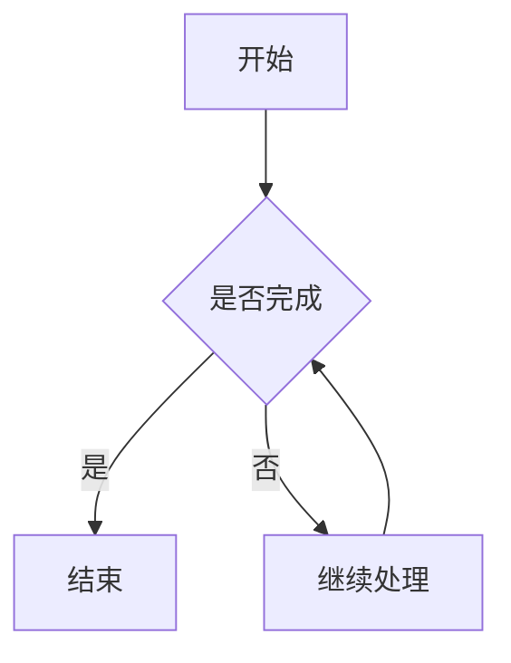
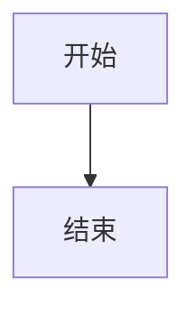

# Markdown Rehype 插件最新使用说明

## 一、插件介绍

**Markdown Rehype** 是 Typecho-Workers 配套的 Markdown 内容解析与 HTML 转换插件。

插件将 Markdown、GFM 扩展语法、部分原始 HTML 和特殊内容统一转换为浏览器可以显示的 HTML，并通过安全白名单过滤，在尽可能保留文章原有排版的同时，限制危险标签、属性和不安全的嵌入内容。

插件针对中文内容、WordPress/Gutenberg 导入内容、SVG、iframe、数学公式、Mermaid 流程图等场景进行了兼容处理。

### 插件基本信息

| 项目 | 信息 |
|---|---|
| 插件名称 | Markdown Rehype |
| 插件 ID | `typecho-plugin-markdown-rehype` |
| 插件版本 | `1.0.0` |
| 当前构建版本 | `2026.11.13.21.10` |
| 作者 | 怸歪 |
| 插件主页 | https://347777.xyz |
| 许可证 | MIT |

---

## 二、Markdown 基础语法与 GFM 扩展

插件支持 CommonMark 和 GitHub Flavored Markdown（GFM）的常用语法。

### 1. 标题

支持一级至六级标题：

```markdown
# 一级标题
## 二级标题
### 三级标题
#### 四级标题
##### 五级标题
###### 六级标题
```

### 2. 文字格式

支持粗体、斜体、删除线和下划线强调。

```markdown
**粗体文字**

*斜体文字*

~~删除的文字~~

++下划线文字++
```

其中：

- `**文字**`：粗体。
- `*文字*`：斜体。
- `~~文字~~`：删除线。
- `++文字++`：下划线强调。

中文环境下还进行了删除线解析兼容处理。

### 3. 上标与下标

目前支持通过原始 HTML 标签实现上标和下标。

```html
X<sup>2</sup>
10<sup>3</sup>

H<sub>2</sub>O
CO<sub>2</sub>
```

显示效果分别为 X²、10³、H₂O 和 CO₂。

需要注意：

- `<sup>` 是 HTML 上标标签。
- `<sub>` 是 HTML 下标标签。
- 目前尚未内置 `X^2^` 和 `H~2~O` 这类 Markdown 扩展语法。
- `~~文字~~` 仍然表示 GFM 删除线，不会被改成下标。

### 4. 引用

使用 `>` 创建引用：

```markdown
> 这是一段引用内容。
>
> 引用内容可以包含多段文字。
```

### 5. 列表

无序列表：

```markdown
- 前端功能
- 后端功能
- 系统设置
```

有序列表：

```markdown
1. 第一步
2. 第二步
3. 第三步
```

支持列表嵌套，通过缩进表示子级内容。

### 6. 任务列表

插件支持 GFM 任务列表，包括嵌套任务列表。

```markdown
- [x] 前端功能
  - [x] 页面布局
  - [x] 响应式设计
  - [ ] 动画效果
- [ ] 后端功能
  - [x] 数据读取
  - [ ] 数据缓存
  - [ ] 权限管理
```

其中：

- `[x]`：已完成。
- `[ ]`：未完成。
- 缩进：表示子任务。

任务列表由插件解析并生成对应 HTML。它主要用于展示任务状态，不是具有后台数据保存能力的任务管理系统；访客点击勾选框不会自动保存任务状态。

### 7. 表格

```markdown
| 名称 | 说明 | 状态 |
|---|---|---|
| Markdown | 内容解析 | 已支持 |
| Rehype | HTML 转换 | 已支持 |
| Mermaid | 流程图 | 已支持 |
```

支持 GFM 表格以及常见的文本对齐方式。

### 8. 自动链接

支持普通链接和自动识别的 URL：

```markdown
[访问网站](https://347777.xyz)

https://347777.xyz
```

### 9. 脚注

```markdown
这里是一段带有脚注的文字。[^1]

[^1]: 这里是脚注的具体内容。
```

插件会生成脚注区域和返回正文的链接。

---

## 三、中文增强与特殊语法

### 1. 中文友好解析

插件集成中文友好解析处理，改善中英文混排、中文标点及部分 Markdown 语法的解析体验。

### 2. Emoji 表情

支持 Emoji 文字名称：

```markdown
今天心情不错 :smile:

这是一个提示 :warning:
```

### 3. 下划线强调

支持：

```markdown
这是一段 ++下划线文字++。
```

转换后使用 HTML 的强调结构显示。

---

## 四、GitHub 风格提示框

插件支持 GitHub 风格的五种 Markdown Alert 提示框：

| 类型 | 用途 |
|---|---|
| NOTE | 普通提示 |
| TIP | 实用建议 |
| IMPORTANT | 重要信息 |
| WARNING | 警告 |
| CAUTION | 注意事项 |

使用示例：

```markdown
> [!NOTE]
> 这是一条普通提示。

> [!TIP]
> 这里可以填写实用建议。

> [!IMPORTANT]
> 这是一条重要信息。

> [!WARNING]
> 请注意相关风险。

> [!CAUTION]
> 操作前请仔细确认。
```

插件会识别提示框结构，转换为对应的 HTML，并自动恢复五种提示框所需的 SVG 图标。

**不需要额外配置图标开关。**

提示框的背景、边框、圆角、文字、标题、图标颜色和内边距可以通过主题 CSS 调整。

注意不要隐藏 SVG 图标，也不要破坏图标容器的显示规则。

---

## 五、代码高亮与代码标题

插件支持代码块语法高亮。

例如：

````markdown
```javascript
const message = 'Hello World';

console.log(message);
```
````

支持：

- 代码语言识别。
- 语法高亮。
- 代码标题。
- 保留代码原始内容。
- 避免代码块中的公式被误识别为普通数学公式。

代码标题示例：

````markdown
```javascript title="示例代码"
console.log('Hello World');
```
````

代码块的背景、边框、圆角、字体、行距和间距由主题 CSS 控制。

代码复制按钮等交互功能以主题自身实现为准，不属于 Markdown Rehype 独立提供的功能。

---

## 六、灵活容器

插件支持扩展的 Markdown 灵活容器语法。

可以将相关内容组织成独立的内容区块，用于说明、提示和其他特殊排版。

容器结构由插件生成，最终背景、边框、颜色和间距由主题 CSS 控制。

---

## 七、数学公式

插件支持两种数学公式引擎：

- **KaTeX**：默认方案，服务端生成公式 HTML。
- **MathJax**：浏览器端运行时处理公式，支持更广泛的 TeX 语法。

### 1. 行内公式

```markdown
这是行内公式：$E=mc^2$

也可以写成：\(E=mc^2\)
```

### 2. 独立公式

```markdown
$$
E=mc^2
$$
```

也可以使用：

```markdown
\[
E=mc^2
\]
```

### 3. 两种引擎的区别

| 对比 | KaTeX | MathJax |
|---|---|---|
| 处理方式 | 服务端渲染 | 浏览器端渲染 |
| 默认状态 | 默认启用 | 需要主动选择 |
| 语法覆盖 | 常用数学公式 | 更广泛的 TeX 语法 |
| 浏览器运行时 | 不需要额外执行 MathJax | 需要 MathJax 运行时 |
| 主题配合 | 需要相应 CSS | 需要主题配合 |

一般文章建议保持默认 KaTeX。

如果文章中存在 KaTeX 无法满足的 TeX 语法需求，可以尝试切换 MathJax。

代码块中的公式内容会保留为代码，不会被公式引擎误处理。

---

## 八、Mermaid 流程图

插件支持识别 Markdown 中的 Mermaid 代码块，并生成浅色和深色两套流程图结构。

示例：

````markdown

````

插件负责：

- 识别 Mermaid 代码块。
- 生成浅色和深色两套流程图结构。
- 为后续主题运行时渲染提供结构。

Warm CY 主题中的 `WarmShell.astro` 负责加载 Mermaid 浏览器运行时并执行渲染。

两套结构分别用于：

- 浅色模式：Mermaid 默认主题。
- 深色模式：Mermaid Dark 主题。

切换网站明暗主题时，可以显示对应配色的流程图。

**兼容说明：**

插件生成流程图结构，不代表所有主题安装后都能自动显示 Mermaid。

其他主题需要自行接入 Mermaid 运行时和相应 CSS。

---

## 九、原始 HTML 支持

插件支持在 Markdown 正文中混合使用原始 HTML。

例如：

```html
<div class="custom-content">
  <h3>自定义内容</h3>
  <p>这里可以使用 HTML 排版。</p>
</div>
```

### 1. 已内置的常见 HTML 标签

插件在原有安全标签集基础上，额外内置了常用标签，包括：

| 标签 | 用途 |
|---|---|
| `button` | 按钮结构 |
| `figure` | 图片或内容区域 |
| `figcaption` | 图片说明 |
| `style` | 样式内容 |
| `mark` | 高亮文字 |
| `sup` | 上标 |
| `sub` | 下标 |
| `details` | 折叠内容 |
| `summary` | 折叠标题 |
| `video` | 视频 |
| `audio` | 音频 |
| `source` | 媒体资源 |
| `iframe` | 嵌入页面 |

同时支持部分 SVG 图形标签和常见 SVG 滤镜元素。

插件还继承 `rehype-sanitize` 默认安全标签集，因此常见 Markdown 和 HTML 结构不需要重复添加到自定义标签白名单。

### 2. WordPress/Gutenberg 内容兼容

插件针对 WordPress/Gutenberg 常见区块结构进行了兼容处理，包括：

- 图片结构。
- 段落和标题。
- 列表和引用。
- 表格。
- 常见布局容器。
- 部分语义化 HTML 结构。

对于从其他系统迁移的文章，可以减少原有 HTML 排版结构在转换过程中的丢失。

### 3. HTML 安全过滤

支持原始 HTML 不代表允许任意 HTML 和 JavaScript 执行。

插件会对 HTML 标签和属性进行安全白名单过滤：

- 只保留允许的 HTML 标签。
- 只保留允许的属性。
- 危险事件处理属性不会因为开启 HTML 支持而获得执行权限。
- `script` 等危险或不允许的标签不会被开放。
- iframe 来源受到单独限制。
- SVG 标签、绘制属性和引用关系受到约束。

**特别提醒：** 文章中如果包含自己编写的 HTML、CSS 或交互内容，应确认来源可信。不要将未知来源的代码直接粘贴到公开文章中。

---

## 十、HTML 标签白名单设置

后台设置项：

**原始 HTML 标签白名单**

### 1. 默认标签

默认额外预置以下常用标签：

```text
u, s, kbd, abbr, small, cite, q, time, del, ins, ruby, rt, rp, wbr, bdi, bdo, data, output, progress, meter
```

常见用途：

| 标签 | 用途 |
|---|---|
| `u` | 下划线文字 |
| `s` | 删除线语义 |
| `kbd` | 键盘按键 |
| `abbr` | 缩写说明 |
| `small` | 小号文字 |
| `cite` | 作品引用 |
| `q` | 行内引用 |
| `time` | 时间语义 |
| `del` | 删除内容 |
| `ins` | 插入内容 |
| `ruby` | 注音排版 |
| `rt` | 注音文字 |
| `rp` | 注音兼容标记 |
| `wbr` | 可换行位置 |
| `bdi` | 双向文字隔离 |
| `bdo` | 双向文字覆盖 |
| `data` | 机器可读数据 |
| `output` | 输出内容 |
| `progress` | 进度信息 |
| `meter` | 数值范围信息 |

### 2. 自定义规则

此设置用于管理额外开放的 HTML 标签。

支持以下分隔方式：

- 空格。
- 英文逗号。
- 中文逗号。
- 英文分号。
- 中文分号。
- 回车换行。

输入框在失去焦点或提交保存时，会自动去重并统一为：

`标签名称, 标签名称, 标签名称`

例如：

```text
u, kbd, abbr, small
```

### 3. 留空与自定义行为

- 留空：关闭本选项管理的全部额外标签。
- 只填写 `u`：只额外放行 `u`。
- 填写 `u, kbd`：只额外放行这两个标签。
- 点击“恢复常用标签默认值”：恢复插件预置列表，之后仍需保存。

注意：留空不会关闭插件原本内置的 HTML 标签，也不会关闭 `sup`、`sub` 等已经内置的功能。

### 4. 安全限制

插件会拒绝危险或文档级标签，例如：

- `script`
- `object`
- `embed`
- `applet`
- `frame`
- `frameset`
- `base`
- `meta`
- `link`
- `form`
- `template`
- `portal`

标签白名单只负责放行标签本身，不会自动开放该标签的任意属性。

例如，允许 `u` 并不意味着可以在 `u` 标签上使用任意事件属性。属性仍然遵循插件原有的安全规则。

---

## 十一、SVG 兼容处理

插件扩展了 SVG 安全白名单，可以保留常见 SVG 绘图结构和必要属性。

支持的结构包括：

- 基础几何图形。
- 路径绘制。
- 填充颜色和描边。
- 渐变。
- 遮罩。
- 裁剪路径。
- 滤镜。
- 本地 SVG 图形引用。

插件会对 SVG 内部 ID 和引用关系进行对应处理，避免安全过滤改变 ID 后导致图形引用失效。

安全限制：

- 不开放事件处理属性。
- 不开放任意外部资源引用。
- 本地 SVG 引用必须符合允许的格式。
- SVG 仍然经过安全白名单过滤。

---

## 十二、iframe 嵌入内容与属性白名单

插件支持在文章中使用 iframe 嵌入受支持的视频和外部内容。

iframe 的安全处理分为两个部分：

1. iframe 来源域名限制。
2. iframe 属性白名单。

两者相互独立。

### 1. 默认允许的嵌入来源

目前固定允许的来源包括：

- YouTube。
- YouTube NoCookie。
- Bilibili 播放器。
- Vimeo 播放器。

自定义 iframe 属性白名单不能扩大来源域名范围。

### 2. 默认属性

插件内置常用属性，包括：

```text
width
height
frameborder
framespacing
border
allow
allowfullscreen
allowtransparency
allowpaymentrequest
title
name
id
class
style
referrerpolicy
sandbox
scrolling
marginwidth
marginheight
loading
credentialless
fetchpriority
align
longdesc
aria-label
aria-hidden
data-diag-id
```

这些属性主要用于控制：

- 宽度和高度。
- 边框。
- 全屏能力。
- 媒体播放权限。
- 加载方式。
- 安全策略。
- 样式和辅助说明属性。

### 3. 自定义属性规则

后台可以添加需要保留的普通 iframe 属性。

支持：

- 空格分隔。
- 英文逗号分隔。
- 中文逗号分隔。
- 英文分号分隔。
- 中文分号分隔。
- 回车换行分隔。

输入框在失去焦点或提交保存时，会自动去重，并统一显示为英文逗号分隔格式。

例如：

```text
width, height, title, class, style, loading, data-custom
```

自定义属性只控制过滤器是否保留属性，不会自动给文章中的 iframe 添加属性。

文章原始 iframe 代码中必须已经存在相应属性。

### 4. 不允许通过白名单开放的属性

以下内容始终受到禁止或单独控制：

- `src`：不通过自定义属性白名单管理，来源地址受固定域名白名单控制。
- `srcdoc`：始终禁止。
- `onload`、`onerror`：始终禁止。
- 其他所有 `on*` 事件属性：始终禁止。
- `nonce`：禁止通过此设置开放。
- `integrity`：禁止通过此设置开放。

### 5. 浏览器兼容提醒

某些 iframe 属性属于旧式或非标准属性。

例如：

`frameborder`、`framespacing`、`border`、`scrolling`、`marginwidth`、`marginheight`、`align`、`longdesc`。

即使白名单保留这些属性，现代浏览器也可能忽略它们。

`credentialless`、`fetchpriority` 等属性取决于浏览器版本。

`allow` 和 `sandbox` 的实际效果还取决于属性值、浏览器安全策略以及嵌入服务本身。

**白名单只负责保留属性，不负责强制浏览器执行不支持的属性。**

### 6. 恢复默认白名单

后台提供“恢复默认白名单”按钮。

点击后会将输入框恢复为插件内置的默认属性列表，之后仍需保存设置。

如果输入为空或内容全部无效，插件会回退到内置默认 iframe 属性白名单。

---

## 十三、图片尺寸控制

插件支持在 Markdown 图片后面添加受限的尺寸参数。

例如：

```markdown
{width=48 height=48}
```

只设置宽度：

```markdown
{width=50%}
```

支持的尺寸形式：

| 写法 | 含义 |
|---|---|
| `width=48` | 宽度 48 像素 |
| `height=48` | 高度 48 像素 |
| `width=48px` | 宽度 48 像素 |
| `width=50%` | 宽度为容器的 50% |
| `height=auto` | 高度自动适配 |

宽度和高度可以同时使用。

插件只接受 `width` 和 `height` 两种尺寸属性，不会把任意 HTML 属性当成图片尺寸参数执行。

### 旧文章兼容

旧文章也可以使用图片 URL fragment 尺寸写法：

```text
image.webp#width=48&height=48
```

插件会识别符合规则的尺寸参数，并转换为图片尺寸设置。

如果 URL fragment 中包含其他内容，则会保留不属于尺寸参数的部分。

---

## 十四、标题锚点与文章内部跳转

插件会自动为 Markdown 标题生成 ID，并在标题后添加可定位的锚点符号 `¶`。

例如：

```markdown
## 三十测试总结
```

会生成带有 `user-content-` 前缀的标题 ID：

```text
user-content-三十测试总结
```

### 1. 跳转到指定标题

可以使用标准 Markdown 链接：

```markdown
[跳转到三十测试总结](#user-content-三十测试总结)
```

点击后会跳转到对应标题。

### 2. 跳转到文章其他位置

例如：

```markdown
## 文章开头

[跳转到文章末尾](#user-content-三十测试总结)

这里是文章中间内容。

## 三十测试总结
```

只要目标标题存在，锚点名称正确，浏览器就可以定位到对应位置。

### 3. 注意事项

- 链接中的锚点必须与实际生成的标题 ID 一致。
- 插件生成的标题 ID 使用 `user-content-` 前缀。
- 中文标题可以直接写在锚点中，浏览器会自动处理 URL 编码。
- 标题文字变化后，对应的锚点也可能变化，需要同步修改链接。
- 主题如果使用固定顶部导航栏，跳转后标题可能被导航栏遮挡；这属于主题滚动定位样式问题，可以通过 `scroll-margin-top` 调整。

---

## 十五、外部链接处理

插件会对文章中的外部链接添加 `nofollow` 属性。

这不会改变正常的链接地址，也不会阻止链接点击。

外部链接仍然可以正常访问，具体打开方式由链接本身和浏览器行为决定。

---

## 十六、后台文章编辑实时预览

插件提供后台文章编辑实时预览功能，并与 Warm CY 主题的编辑器环境配合。

### 1. 主要功能

- 编辑正文时自动监听内容变化。
- 正文变化后自动更新预览。
- 使用插件的 Markdown 转换流程生成预览内容。
- 支持代码高亮。
- 支持数学公式。
- 支持 Mermaid 预览。
- 预览区域采用隔离 iframe 显示。
- 适应编辑器区域尺寸和主题明暗状态。

### 2. 预览更新机制

编辑器输入停止约 280 毫秒后，插件安排一次预览更新，避免每输入一个字符就立即提交请求。

预览请求通过插件自己的后台接口处理：

`/api/admin/markdown-rehype-preview`

接口要求具备 contributor 或更高权限，并使用后台请求的安全校验。

单次预览正文最大长度为 100,000 个字符。

### 3. 兼容范围

实时预览依赖 Warm CY 主题后台编辑器结构，目前不是保证适用于所有 Typecho 主题的通用预览功能。

其他主题如果希望使用同样的实时预览，需要自行接入相应的后台编辑器结构和前端运行时。

---

## 十七、后台设置选项详解

目前插件主要提供四个配置项。

### 1. 数学公式引擎

**默认值：KaTeX**

用于选择 Markdown 数学公式的渲染方式。

可选：

- KaTeX（推荐）。
- MathJax。

一般文章建议保持 KaTeX。

遇到 KaTeX 无法满足的 TeX 语法需求时，可以尝试 MathJax。

### 2. 启用 Rehype 目录生成

**默认值：关闭**

用于控制插件是否生成文章目录。

开启后，只有当 Markdown 正文中存在明确的二级标题：

```markdown
## 目录
```

插件才会识别该位置并生成目录。

例如：

```markdown
## 目录

## 插件介绍

## 功能说明

### 数学公式

### Mermaid 流程图

## 安全说明
```

如果 Warm CY 主题已经使用自己的目录功能，建议保持此选项关闭，避免出现重复目录。

### 3. 原始 HTML 标签白名单

用于管理额外允许的 HTML 标签。

默认已经预置常用标签，通常不需要修改。

如果文章需要使用其他标签，可以添加对应标签名称。

留空只关闭本设置额外管理的标签，不会关闭插件已经内置的标签。

### 4. iframe 属性白名单

用于控制文章中的 iframe 可以保留哪些普通属性。

默认白名单已经覆盖常见需求。

只有文章确实需要额外属性时才建议修改。

注意不能通过此项放开 iframe 来源域名，也不能开放危险事件属性或 `srcdoc`。

---

## 十八、与 Warm CY 主题的配合关系

Markdown Rehype 与 Warm CY 主题是配套关系，但两者负责的工作不同。

| 功能 | 负责部分 |
|---|---|
| Markdown 解析 | Markdown Rehype |
| GFM 扩展语法 | Markdown Rehype |
| 中文友好解析 | Markdown Rehype |
| HTML 安全过滤 | Markdown Rehype |
| SVG 兼容处理 | Markdown Rehype |
| iframe 属性过滤 | Markdown Rehype |
| KaTeX 公式输出 | Markdown Rehype |
| MathJax 浏览器端排版 | Warm CY 配合 |
| Mermaid 代码块结构 | Markdown Rehype |
| Mermaid 浏览器端渲染 | Warm CY 配合 |
| Mermaid 明暗主题切换 | Warm CY 配合 |
| 公式、代码和提示框外观 | 主题 CSS |
| 后台文章实时预览 | Markdown Rehype 与 Warm CY 配合 |

其他主题可以复用插件生成的 HTML，但如果需要完整使用 Mermaid、MathJax 和配套样式，需要主题自行接入相应运行时和 CSS。

---

## 十九、与 CY 服务插件的兼容说明

CY 服务插件中有一项：

**正文 HTML / CSS / JavaScript 增强**

该功能与 Markdown Rehype 的原始 HTML 解析及安全处理流程存在冲突。

使用 Markdown Rehype 时，建议：

- 正常启用 Markdown Rehype。
- CY 服务插件的正文 HTML / CSS / JavaScript 增强保持关闭。
- 不要同时让两个插件处理同一篇文章的 HTML 增强流程。

如果网站文章主要使用 Markdown，建议由 Markdown Rehype 统一负责 Markdown 转换。

---

## 二十、常见问题

### 1. 为什么上标和下标没有按 `X^2^`、`H~2~O` 显示？

目前插件支持 HTML 标准标签写法：

```html
X<sup>2</sup>

H<sub>2</sub>O
```

但尚未内置 `^...^` 和 `~...~` Markdown 扩展解析。

`~~...~~` 仍然表示删除线。

### 2. 为什么任务列表没有显示勾选框？

先检查是否使用正确的 GFM 任务列表格式：

```markdown
- [x] 已完成
- [ ] 未完成
```

插件负责生成任务列表 HTML。如果页面只显示普通文本或没有对应样式，需要进一步检查 Markdown 解析结果和主题 CSS。

任务列表不是可持久化的在线任务管理系统。

### 3. 为什么文章内部跳转没有定位？

检查目标标题是否真实存在，并确认锚点带有：

```text
#user-content-
```

例如：

```markdown
[跳转](#user-content-三十测试总结)
```

如果标题文字修改过，需要同步修改锚点。

### 4. 为什么 Mermaid 代码没有显示成流程图？

检查是否使用标准 Mermaid 代码块：

````markdown

````

Markdown Rehype 负责生成流程图结构，Warm CY 负责加载 Mermaid 运行时并渲染。

如果页面仍然显示原始代码，需要检查主题对应的 Mermaid 运行时是否正常加载。

### 5. 为什么 MathJax 没有正常显示？

MathJax 需要浏览器端运行时。

除了插件选择 MathJax 外，还需要主题配合加载对应运行时。

### 6. 为什么开启目录后没有生成目录？

检查文章中是否存在明确的：

```markdown
## 目录
```

插件不会因为开启目录选项就自动为所有文章添加目录标题。

如果主题已经提供目录功能，建议关闭插件的目录生成。

### 7. 为什么某些 HTML 标签没有显示？

检查标签是否已经内置，或者是否添加到了原始 HTML 标签白名单。

危险标签不能通过自定义设置开放。

### 8. 为什么 HTML 标签的某些属性没有保留？

标签白名单和属性白名单是两套独立规则。

允许某个 HTML 标签，不代表它的所有属性也会自动放行。

属性仍然受到原有安全规则约束。

### 9. 为什么 iframe 属性填写后仍然没有效果？

先确认文章原始 iframe 代码中确实存在该属性。

然后确认浏览器和嵌入服务支持该属性。

白名单只负责保留，不负责自动添加属性，也不能强制浏览器执行不支持的属性。

### 10. 为什么图片尺寸没有生效？

检查语法是否正确：

```markdown
{width=48 height=48}
```

目前只支持 `width` 和 `height`，尺寸值必须符合插件允许的数字、百分比或 `auto` 格式。

### 11. 为什么原始 HTML 的排版发生变化？

插件会统一解析 Markdown 和原始 HTML，并经过安全白名单过滤。

不在允许范围内的标签和属性可能在转换过程中被移除。

需要检查对应标签、属性是否允许，以及主题 CSS 是否匹配转换后的 HTML 结构。

---

## 二十一、推荐配置

对于一般的 Warm CY 博客，建议使用以下配置：

| 配置项 | 建议 |
|---|---|
| 数学公式引擎 | KaTeX |
| Rehype 目录生成 | 关闭（主题已有目录时） |
| 原始 HTML 标签白名单 | 保持默认 |
| iframe 属性白名单 | 保持默认 |
| CY 正文 HTML / CSS / JavaScript 增强 | 关闭 |
| Mermaid | 使用标准 Mermaid 代码块 |
| 数学公式 | 使用标准公式定界符 |
| 上标与下标 | 使用 `<sup>`、`<sub>` |
| 文章内部跳转 | 使用 `#user-content-标题ID` |

一般情况下保持默认设置即可。

只有在确实需要额外 HTML 标签、特殊 iframe 属性、MathJax 或独立目录时，才需要调整对应选项。

---

## 二十二、插件的设计原则

Markdown Rehype 的主要目标是统一文章内容解析、HTML 转换和安全过滤流程。

插件遵循以下原则：

1. 尽可能兼容标准 Markdown 和常见扩展语法。
2. 尽可能保留原有文章 HTML 结构。
3. 对常见迁移内容提供兼容处理。
4. HTML、SVG 和 iframe 均通过安全白名单控制。
5. 不通过自定义白名单开放危险脚本或事件属性。
6. 将内容解析与主题展示分开，减少对主题和核心代码的侵入。
7. 对需要浏览器端执行的功能，由主题负责加载相应运行时。

**Markdown Rehype 不是关闭安全限制的 HTML 执行器，而是一个兼顾内容兼容性、扩展能力和安全过滤的 Markdown 渲染插件。**