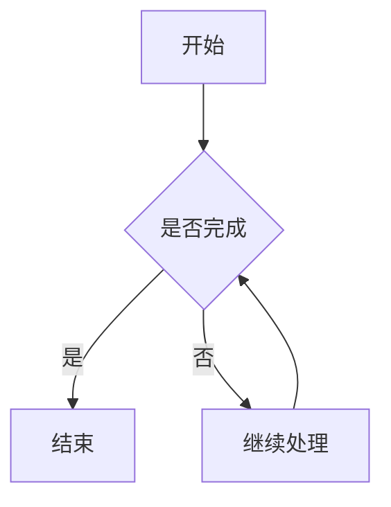
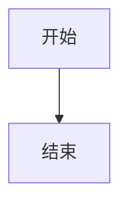

# Markdown Rehype 插件详细使用说明

## 一、插件介绍

**Markdown Rehype** 是 Typecho-Workers 配套的 Markdown 内容解析与 HTML 转换插件。

它的主要作用是：将文章中的 Markdown、部分原始 HTML 和扩展语法统一处理，转换为浏览器可以显示的 HTML，同时进行安全过滤，尽可能保留文章原有的排版、图片、公式、流程图和交互内容。

插件不仅支持常见 Markdown 语法，还针对中文内容、WordPress/Gutenberg 导入内容、SVG、iframe、数学公式以及 Mermaid 流程图进行了兼容处理。

**插件基本信息**

- 插件名称：Markdown Rehype
- 插件 ID：`typecho-plugin-markdown-rehype`
- 插件版本：`1.0.0`
- 当前构建版本：`2026.11.13.10.49`
- 插件作者：怸歪
- 插件主页：https://347777.xyz

## 二、主要功能

### 1. 标准 Markdown 与 GFM 扩展

插件支持 CommonMark 和 GitHub Flavored Markdown（GFM）常用语法。

包括：

- 标题：一级至六级标题。
- 粗体：`**粗体文字**`
- 斜体：`*斜体文字*`
- 删除线：`~~删除的文字~~`
- 引用：使用 `>` 创建引用块。
- 有序列表和无序列表。
- 自动链接。
- 表格。
- 任务列表。
- 脚注。

例如，任务列表：

```markdown
- [x] 已完成的事项
- [ ] 尚未完成的事项
```

表格：

```markdown
| 名称 | 说明 |
| --- | --- |
| Markdown | 内容编写 |
| Rehype | HTML 转换 |
```

脚注：

```markdown
这里是一段带有脚注的文字。[^1]

[^1]: 这里是脚注的具体内容。
```

插件会自动将这些内容转换成相应的 HTML 结构。

### 2. 中文友好解析

插件集成了中文友好解析处理。

主要用于改善中英文混排、中文标点及部分 Markdown 语法在中文内容中的解析体验。

同时支持额外的文字格式：

- Emoji 表情语法。
- 下划线强调语法。
- 中文环境下的删除线兼容。

例如：

```markdown
这是 ++需要强调的文字++。

今天心情不错 :smile:
```

其中 `++文字++` 用于下划线强调，`:smile:` 用于 Emoji 表情。

### 3. GitHub 风格提示框

插件支持 GitHub 风格的五种提示框：

- NOTE：普通提示。
- TIP：实用建议。
- IMPORTANT：重要信息。
- WARNING：警告。
- CAUTION：注意事项。

使用示例：

```markdown
> [!NOTE]
> 这是一条普通提示。

> [!TIP]
> 这里可以填写一些实用建议。

> [!IMPORTANT]
> 这是一条重要信息。

> [!WARNING]
> 请注意相关风险。

> [!CAUTION]
> 操作前请仔细确认。
```

插件会识别这些结构，并生成对应的提示框 HTML。

同时会自动恢复提示框所需的 SVG 图标，不需要额外安装图标插件，也不需要单独配置图标。

提示框的背景、边框、文字、标题、图标颜色等外观可以通过主题 CSS 调整。只要不隐藏图标 SVG 或破坏图标容器的显示规则，修改普通样式不会影响图标恢复。

**注意：** CY 服务插件也包含独立的 Markdown Alert 图标恢复功能。两者属于不同插件中的处理逻辑，不应将 CY 服务插件的功能误认为 Markdown Rehype 的配置选项。

### 4. 代码高亮

插件支持代码块语法高亮。

例如：

````markdown
```javascript
const message = 'Hello World';

console.log(message);
```
````

插件会识别代码块的语言标记，并生成带有语言信息和高亮结构的 HTML。

支持的代码块处理还包括：

- 代码语言识别。
- 语法高亮。
- 代码标题。
- 保留代码原始内容。
- 代码块中的公式内容不会被当成普通数学公式转换。

代码块的背景、边框、圆角、字体、行距和间距等外观由主题 CSS 控制。

代码复制按钮的交互与显示应以主题自身实现为准，不能把主题已有的复制功能误认为 Markdown Rehype 独立提供的功能。

### 5. 灵活容器

插件支持扩展的 Markdown 容器语法，可以将指定内容转换为带有标题和容器结构的 HTML。

主要用于组织提示内容、说明文字和其他特殊内容区块。

容器本身的结构由插件生成，最终的背景、边框、颜色和间距由主题 CSS 决定。

### 6. 数学公式

插件支持两种数学公式引擎：

- KaTeX：默认方案，服务端生成公式 HTML。
- MathJax：由浏览器端运行时完成公式排版，支持更广泛的 TeX 语法。

支持四种公式定界符：

**行内公式**

```markdown
这是行内公式：$E=mc^2$

也可以写成：\(E=mc^2\)
```

**独立公式**

```markdown
$$
E=mc^2
$$
```

也可以使用：

```markdown
\[
E=mc^2
\]
```

四种形式均属于插件需要识别的公式语法。

代码块中的公式内容会保留为代码，不会被公式引擎误处理。

**KaTeX 与 MathJax 的区别：**

| 对比 | KaTeX | MathJax |
|---|---|---|
| 处理方式 | 服务端渲染 | 浏览器端渲染 |
| 默认状态 | 默认选项 | 需要主动选择 |
| 语法覆盖 | 常用数学公式 | 支持更广泛的 TeX 语法 |
| 浏览器运行时 | 不需要额外执行 MathJax | 需要 MathJax 运行时 |
| 显示样式 | 需要相应 CSS | 需要主题配合 |

一般文章中的数学公式，建议使用默认的 KaTeX。只有在遇到 KaTeX 无法满足的 TeX 语法需求时，再考虑切换 MathJax。

### 7. Mermaid 流程图

插件能够识别 Markdown 中的 Mermaid 代码块，并生成浅色和深色两套流程图待渲染结构。

示例：

````markdown

````

插件负责识别 Mermaid 代码并生成两套对应结构。

Warm CY 主题中的 `WarmShell.astro` 负责加载 Mermaid 浏览器运行时，并执行流程图渲染。

两套结构分别用于：

- 浅色模式：使用 Mermaid 默认主题。
- 深色模式：使用 Mermaid Dark 主题。

因此，切换网站明暗主题时，可以显示相应配色的流程图。

**注意：** 插件生成流程图结构，不代表所有主题安装后都能自动显示 Mermaid。其他主题需要自行接入 Mermaid 运行时和相应样式。

### 8. 原始 HTML 支持

插件支持在 Markdown 文章中混合使用 HTML。

例如：

```html
<div class="custom-content">
  <h3>自定义内容</h3>
  <p>这里可以使用 HTML 排版。</p>
</div>
```

支持处理的 HTML 结构包括：

- 常见段落和标题标签。
- 列表、引用和表格。
- `div`、`section`、`article` 等布局容器。
- `figure`、`figcaption` 等图片结构。
- `details`、`summary` 等折叠内容。
- `mark`、`sup`、`sub` 等文本格式。
- `video`、`audio`、`source` 等媒体结构。
- `iframe` 嵌入内容。
- 部分 SVG 图形结构。
- `style` 样式内容。

插件还针对 WordPress/Gutenberg 常见区块结构进行了兼容处理，包括图片、段落、标题、列表、引用、表格和常见布局容器。

这对于迁移过来的文章尤其有用，可以减少原有 HTML 内容在转换过程中丢失排版结构的情况。

### 9. HTML 安全过滤

插件虽然支持原始 HTML，但并不是不加限制地执行 HTML。

内容会经过 HTML 解析和安全白名单过滤。

主要处理原则：

- 只保留允许的 HTML 标签。
- 只保留允许的属性。
- 危险事件处理属性不会因为开放 HTML 解析而自动获得执行权限。
- `script` 等未获准标签不会自动执行。
- iframe 的属性受到白名单限制。
- SVG 的标签、绘制属性和引用关系受到约束。

**特别说明：** 支持 HTML 不等于允许任意 JavaScript 执行。不要把插件的 HTML 兼容能力理解为关闭了安全过滤。

### 10. SVG 兼容处理

插件扩展了 SVG 安全白名单，可以保留常见 SVG 绘图结构和必要属性。

包括：

- 基础几何图形。
- 路径绘制。
- 填充颜色和描边。
- 渐变。
- 遮罩。
- 裁剪路径。
- 滤镜。
- 本地 SVG 图形引用。

对于 SVG 内部的 ID 和引用关系，插件还会进行对应处理，避免安全过滤改变 ID 后导致图形引用失效。

这里的兼容并不是取消 SVG 安全限制：

- 不开放事件处理属性。
- 不开放任意外部资源引用。
- 本地 SVG 引用必须符合允许的格式。
- SVG 仍然经过安全白名单过滤。

### 11. 图片尺寸控制

插件支持在 Markdown 图片后面添加受限的尺寸参数。

例如：

```markdown
{width=48 height=48}
```

也可以只设置宽度：

```markdown
{width=50%}
```

支持的尺寸形式：

| 写法 | 含义 |
|---|---|
| `width=48` | 宽度 48 像素 |
| `height=48` | 高度 48 像素 |
| `width=48px` | 宽度 48 像素 |
| `width=50%` | 宽度为容器的 50% |
| `height=auto` | 高度自动适配 |

宽度和高度可以同时使用。

插件只接受 `width` 和 `height` 两种尺寸属性，不会将任意 HTML 属性当成图片参数执行。

**旧文章兼容：**

如果旧文章的图片 URL 使用了类似下面的形式：

```text
image.webp#width=48&height=48
```

插件会识别符合规则的尺寸参数，并转换为图片尺寸设置。

如果 URL fragment 中包含其他内容，则会保留不属于尺寸参数的部分，避免无关链接信息丢失。

### 12. 标题锚点

插件会自动为文章标题生成 ID，并在标题后添加可定位的锚点符号。

例如，文章中存在：

```markdown
## 插件介绍
```

转换后会生成对应的标题 ID，并在标题后增加一个可用于定位的锚点。

主要作用：

- 支持文章内部跳转。
- 方便目录链接定位。
- 可以直接复制标题对应的锚点链接。
- 为目录生成提供标题定位基础。

插件生成的标题 ID 使用 `user-content-` 前缀，以减少与页面其他元素的 ID 冲突。

### 13. 外部链接处理

插件会对文章中的外部链接进行处理，为链接添加 `nofollow` 属性。

这样可以明确告诉搜索引擎，文章中的外部链接不应被直接视为普通推荐关系。

这不会改变正常的链接地址，也不意味着链接无法点击。

## 三、后台设置选项详解

Markdown Rehype 当前有四个主要配置项。

### 1. 数学公式引擎

<text>默认值：KaTeX（推荐）</text>

用于选择文章数学公式的处理方式。

可选：

- **KaTeX（推荐）**：通过服务端完成公式渲染，适合一般文章使用。
- **MathJax**：由浏览器端运行时处理公式，支持更广泛的 TeX 语法。

建议：

一般用户保持默认 KaTeX 即可。

如果文章中存在较复杂的 TeX 语法，KaTeX 无法满足需求，再尝试 MathJax。

切换后，文章和后台实时预览都会根据选择的公式引擎进行处理。

### 2. 启用 Rehype 目录生成

<text>默认值：关闭</text>

用于控制插件是否生成文章目录。

开启后，只有当 Markdown 正文中存在明确的二级标题：

```markdown
## 目录
```

插件才会根据后续标题生成目录。

例如：

```markdown
## 目录

## 插件介绍

## 功能说明

### 数学公式

### Mermaid 流程图

## 安全说明
```

插件会识别目录标题，并根据文章标题结构生成对应目录。

**为什么默认关闭？**

因为 Warm CY 主题本身可能已经提供文章目录功能。

如果主题已经生成目录，再开启插件的目录功能，就可能出现两个目录重复显示的情况。

因此：

- 使用主题自带目录：保持关闭。
- 希望由 Markdown Rehype 生成目录：开启此选项，并在文章中添加 `## 目录` 标题。
- 没有 `## 目录` 标题：不会因为开启该选项就自动在文章顶部生成目录。

### 3. 原始 HTML 标签白名单

<text>默认值：预置常用安全标签</text>

用于控制 Markdown 正文中原始 HTML 可以使用哪些额外标签。每行填写一个标签名称。

默认预置：

```text
u
s
kbd
abbr
small
cite
q
time
del
ins
ruby
rt
rp
wbr
bdi
bdo
data
output
progress
meter
```

常见用途：

- `u`：下划线文字。
- `s`、`del`：删除线。
- `kbd`：键盘按键。
- `abbr`：缩写说明。
- `small`：小号文字。
- `cite`、`q`：引用语义。
- `time`：时间语义。
- `ruby`、`rt`、`rp`：注音排版。

**自定义规则：**

- 每行填写一个标签，也支持空格、逗号或分号分隔。
- 填写符合标准标签名称格式的标签即可；危险标签会被强制拒绝。
- 输入框留空时，关闭本选项管理的全部可选标签。
- 只填写哪些标签，就额外放行哪些标签。
- 点击“恢复常用标签默认值”可恢复预置列表；恢复后仍需保存设置。
- 标签属性仍由现有 HTML 属性安全白名单单独控制，不会开放事件属性、脚本或危险标签。

例如，只填写 `u` 和 `kbd`，则只额外放行这两个标签。

### 4. iframe 属性白名单

<text>默认值：插件内置白名单</text>

用于控制文章中的 iframe 可以保留哪些 HTML 属性。

每行填写一个属性名称。

默认白名单包括：

```text
width
height
frameborder
framespacing
border
allow
allowfullscreen
allowtransparency
allowpaymentrequest
title
name
id
class
style
referrerpolicy
sandbox
scrolling
marginwidth
marginheight
loading
credentialless
fetchpriority
align
longdesc
aria-label
aria-hidden
data-diag-id
```

这些属性主要用于控制 iframe 的：

- 宽度和高度。
- 边框。
- 全屏能力。
- 媒体播放权限。
- 加载方式。
- 安全策略。
- 样式和辅助说明属性。

**如何修改？**

如果某个 iframe 使用了额外的普通属性，而该属性不在默认白名单中，可以将属性名称添加到文本框中。

例如：

```text
width
height
title
class
style
loading
data-custom
```

插件支持使用换行、空格、逗号或分号分隔属性名称。

修改后需要保存设置。

**恢复默认白名单**

设置区域提供了“恢复默认白名单”按钮。

点击后会将文本框恢复为插件内置的默认属性列表，之后还需要点击保存设置，才会正式保存。

**重要安全限制：**

以下内容不能通过自定义白名单开放：

- `src`
- `srcdoc`
- `onload`
- `onerror`
- 其他 `on*` 事件属性
- `nonce`
- `integrity`

其中 iframe 的 `src` 地址有独立的固定安全限制，默认只允许指定的嵌入来源，包括：

- YouTube
- YouTube NoCookie
- Bilibili 播放器
- Vimeo 播放器

因此，iframe 属性白名单只是控制允许保留的属性，并不是任意 iframe 域名授权列表。

不要为了让某个 iframe 显示而尝试通过增加 `src` 或事件属性来绕过安全限制。

## 四、后台文章编辑实时预览

Markdown Rehype 还提供了后台文章编辑实时预览功能。

在 Warm CY 主题环境下，进入后台新建或编辑文章、独立页面时，插件会接入编辑器预览区域。

主要功能：

1. 编辑文章时自动监听正文变化。
2. 正文发生变化后自动安排预览更新。
3. 使用与文章正式输出相同的 Markdown 转换流程。
4. 支持公式和 Mermaid 预览。
5. 根据浅色、深色主题处理对应的显示效果。
6. 预览区域会根据内容高度调整显示区域。

预览采用延迟更新方式，输入停止一小段时间后再提交转换请求，避免每输入一个字符都立即发起处理。

预览区域使用隔离的 iframe 显示内容，并通过后台受权限保护的预览接口获取转换结果。

**注意：** 实时预览依赖 Warm CY 主题的后台编辑器结构，目前不是脱离主题后可保证适用于所有 Typecho 主题的通用预览功能。

## 五、与 Warm CY 主题的配合关系

Markdown Rehype 与 Warm CY 主题是配套关系，但二者负责的工作并不完全相同。

| 功能 | 负责部分 |
|---|---|
| Markdown 解析 | Markdown Rehype |
| GFM 扩展语法 | Markdown Rehype |
| HTML 安全过滤 | Markdown Rehype |
| SVG 兼容处理 | Markdown Rehype |
| KaTeX 公式输出 | Markdown Rehype |
| MathJax 浏览器端排版 | Warm CY 主题配合 |
| Mermaid 代码块结构 | Markdown Rehype |
| Mermaid 浏览器端渲染 | Warm CY 主题配合 |
| Mermaid 明暗主题切换 | Warm CY 主题配合 |
| 公式、代码和提示框外观 | Warm CY 主题 CSS |
| 后台文章实时预览 | Markdown Rehype 与 Warm CY 配合 |

这意味着 Markdown Rehype 不只是一个简单的 Markdown 语法插件，而是整个文章内容转换流程的一部分。

其他主题可以复用插件生成的 HTML，但如果需要完整使用 Mermaid、MathJax 和配套样式，需要主题自行接入相应的运行时与 CSS。

## 六、与 CY 服务插件的兼容说明

<text>重要：请不要同时开启两个插件之间存在冲突的功能。</text>

CY 服务插件中有一个配置项：

**正文 HTML / CSS / JavaScript 增强**

该功能与 Markdown Rehype 的原始 HTML 解析及安全处理流程存在冲突。

因此，使用 Markdown Rehype 时：

- Markdown Rehype 正常启用。
- CY 服务插件的“正文 HTML / CSS / JavaScript 增强”保持关闭。
- 不要同时使用两个插件处理同一篇文章的 HTML 增强流程。

如果网站主要使用 Markdown 文章，建议由 Markdown Rehype 统一负责 Markdown 转换。

## 七、常见问题

### 1. 为什么 Mermaid 代码没有显示成流程图？

先确认文章中使用的是正确的 Mermaid 代码块格式：

````markdown

````

Markdown Rehype 负责识别 Mermaid 代码并生成两套结构，Warm CY 主题负责加载浏览器运行时并执行渲染。

如果只是显示代码而没有生成流程图，需要检查主题对应的 Mermaid 运行时是否正常加载。

### 2. 为什么选择 MathJax 后公式没有正常显示？

MathJax 使用浏览器端运行时进行公式排版。

因此，除了插件配置外，还需要主题配合加载 MathJax 运行时。

如果使用 Warm CY 主题，应优先检查主题对应的运行时是否正常加载，以及浏览器控制台是否存在加载错误。

### 3. 为什么开启目录后没有生成目录？

检查文章正文中是否存在明确的：

```markdown
## 目录
```

插件只在识别到这个标题时生成目录，不会自动为所有文章添加目录标题。

另外，如果主题已经生成目录，建议关闭插件的 Rehype 目录功能，避免重复。

### 4. 为什么 HTML 中的某些内容没有显示？

插件会对原始 HTML 进行安全白名单过滤。

如果标签、属性或内容不在允许范围内，就可能在转换过程中被移除。

尤其是 JavaScript、事件属性和不受信任的嵌入内容，不会因为开启 HTML 支持就自动获得执行权限。

### 5. 为什么 iframe 的某些属性没有保留？

检查后台的 iframe 属性白名单。

如果属性名称不在白名单中，可以尝试添加允许的普通属性。

但 `src`、`srcdoc` 和危险事件属性始终不能通过自定义白名单开放；iframe 的来源地址还受到单独的域名限制。

### 6. 为什么图片尺寸设置没有生效？

检查图片尺寸语法是否正确。

例如：

```markdown
{width=48 height=48}
```

目前只支持 `width` 和 `height`，尺寸值必须符合插件允许的数字、百分比或 `auto` 格式。

任意 HTML 属性或不符合格式的尺寸参数不会被识别为图片尺寸设置。

### 7. 为什么启用插件后，文章的 HTML 样式发生变化？

Markdown Rehype 会统一解析 Markdown 和原始 HTML，并经过安全白名单过滤。

部分原始 HTML 属性可能不在允许范围内，因此转换后的 HTML 结构与原始内容可能存在差异。

如果文章依赖特殊 HTML 结构，需要检查相应标签和属性是否被允许，同时确认主题 CSS 是否匹配转换后的结构。

## 八、使用建议

为了获得比较稳定的使用效果，建议采用以下配置：

| 设置项 | 建议 |
|---|---|
| 数学公式引擎 | KaTeX |
| Rehype 目录生成 | 关闭（主题已有目录时） |
| iframe 属性白名单 | 保持默认 |
| CY 正文 HTML / CSS / JavaScript 增强 | 关闭 |
| Mermaid | 使用标准 Mermaid 代码块 |
| 数学公式 | 优先使用标准定界符 |
| 原始 HTML | 只使用可信、必要的内容 |

对于一般博客文章，保持默认配置即可。

只有在确实需要更广泛的 TeX 语法、独立目录或者特殊 iframe 属性时，才需要调整对应选项。

**最后说明：** Markdown Rehype 的重点是统一内容解析、转换和安全过滤，而不是让文章中的任何 HTML 或 JavaScript 不受限制地运行。它与 Warm CY 主题配合后，可以提供更完整的 Markdown 写作和阅读体验。