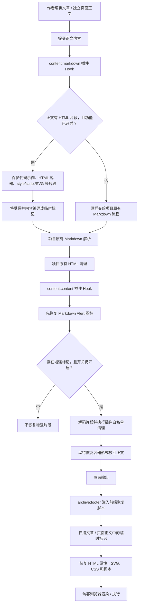

# 正文 HTML / CSS / JavaScript 增强机制详解

> 本文专门解释 CY 配套插件中的“正文 HTML / CSS / JavaScript 增强”功能。内容依据当前稳定版 `src/plugins/typecho-plugin-warm-cy/index.ts` 的实现整理，重点说明它怎样穿过 Markdown 渲染与 HTML 清理流程、怎样在浏览器中恢复，以及它的安全边界。
>
> 功能开关：`htmlEnhancementEnabled`  
> 后台入口：**设置 → CY 功能显示 → 正文 HTML / CSS / JavaScript 增强**  
> 默认状态：**关闭**  
> 生效范围：Warm CY 主题下的文章正文和独立页面正文。

---

## 1. 这个功能究竟解决什么问题

一般的 Markdown 内容处理流程会把作者输入的 Markdown 转成 HTML，并经过 HTML 清理器。清理器会移除或规范化一些不在允许范围内的标签、属性和内容。这样可以降低 XSS 等风险，但也会影响一些需要更完整 HTML 能力的正文：

- 自定义 HTML 容器的 `class`、`id`、`data-*`、`aria-*` 属性可能被过滤。
- 元素的内联 `style` 可能被清理或只保留有限样式。
- `<style>` 样式块可能无法按作者预期保留。
- `<script>` 脚本块不能简单地依靠普通 HTML 清理流程保留并执行。
- SVG 可能因为 HTML 清理器规范化属性名称而出现渲染问题。
- 完整的 HTML 容器可能被 Markdown 的块级解析规则拆开，导致空行较多的布局片段结构不完整。
- iframe 的播放地址及相关属性可能在清理过程中丢失。

CY 插件的增强功能就是在不直接关闭整个站点 HTML 清理流程的前提下，为可信内容提供一条受控通道：先保护特定片段，经过项目原有 Markdown 和清理流程后，再按插件自己的允许列表恢复。

**它不是“允许正文执行任意 HTML”的总开关，也不是把所有安全过滤器全部关闭。**

## 2. 从后台开关到前台运行：整体流程

功能需要同时满足几个条件：

1. CY 配套插件已安装并在后台启用。
2. 当前使用 Warm CY 主题。
3. 在「CY 功能显示」页面主动打开“正文 HTML / CSS / JavaScript 增强”。
4. 保存设置成功。
5. 正文内容包含需要增强处理的 HTML 片段。

设置保存到 D1 的插件私有选项：

```
plugin:typecho-plugin-warm-cy
  └─ htmlEnhancementEnabled: "1" | "0"
```

该开关默认按关闭处理。插件读取设置时，只有明确启用才会进入增强路径。插件不会要求修改主题核心文件、Markdown 核心文件或内容保存 API。

### 2.1 处理链路图



这里有一个关键设计：**HTML 片段不是在 Markdown 解析之前就直接放回页面，而是先变成普通文本标记，等核心 Markdown 和清理流程完成后再恢复。** 这样可以避免 Markdown 解析器把复杂 HTML 拆散，也避免核心清理器在中途直接删除尚未恢复的脚本或样式内容。

## 3. 第一阶段：Markdown 处理前保护正文片段

入口是插件注册的 `content:markdown` hook。

### 3.1 先做轻量判断，避免无意义读取设置

如果正文既没有类似 HTML 标签的内容，也没有插件内部的标记，hook 会直接返回原内容，不读取 HTML 增强开关。

如果正文出现 HTML 标签形态或内部标记，插件才通过插件 SDK 的 `getOption()` 读取 `plugin:typecho-plugin-warm-cy` 设置，再判断 `htmlEnhancementEnabled` 是否开启。

这样做的目的是：普通纯 Markdown 文章不需要为了这个功能额外走完整的保护处理。

### 3.2 先保护代码示例，避免把代码当成真实 HTML

在处理 HTML 之前，插件会保护以下代码内容：

- `<pre>...</pre>` 代码块；
- `<code>...</code>` 行内或块级代码；
- Markdown 反引号围栏代码块（支持反引号和波浪号围栏）；
- Markdown 缩进式代码块；
- 行内反引号代码。

例如下面这段是代码示例，不应该被插件当成需要执行的脚本：

```html
<script>
  alert('这只是文档里的代码示例');
</script>
```

保护后，代码内容会暂时替换为插件内部占位标记。后续恢复时再放回原内容。这样可以避免文档中的示例代码被误识别为真实脚本。

### 3.3 识别完整 HTML 文档输入

文章正文通常应该是 HTML 片段，但作者也可能粘贴完整的 HTML 文档结构。

插件会识别类似：

```html
<!doctype html>
<html>
<head>
  <title>示例</title>
  <style>.demo { color: red; }</style>
</head>
<body>
  <div class="demo">正文内容</div>
</body>
</html>
```

这类输入不是在文章中再嵌套一个完整浏览器文档。插件会提取：

- `<head>` 中的完整 `<style>` 和 `<script>` 块；
- `<body>` 中的正文内容。

文档级的 doctype、html/head/body 外壳和普通 metadata 不会作为一个完整嵌套文档输出。提取出的样式、脚本和正文片段再进入后续保护流程。

### 3.4 保护 style、script、SVG 和特殊链接

插件会把完整的以下元素片段编码为内部标记：

- `<style>...</style>`
- `<script>...</script>`
- `<svg>...</svg>`
- 含内联 style 或嵌套 SVG 的完整链接片段（例如带 SVG 图标的下载卡片）。

编码使用 UTF-8 字节转十六进制字符串，放进形如 `CYCYINLINEBLOCKX...XEND` 的临时标记中。

为什么要编码，而不只是给标签换个名字？

因为 Markdown 解析器和 HTML 清理器面对的是普通文本标记，不会把其中的脚本、CSS 或 SVG 当成真实活动元素处理。等经过核心处理后，插件才有机会按自己的规则恢复。

### 3.5 保护完整容器，避免 Markdown 空行规则拆散结构

插件还会尝试把完整的容器元素整体保护起来，包括：

`main`、`article`、`section`、`aside`、`div`、`header`、`footer`、`nav`、`figure`、`form`、`fieldset`、`details`、表格相关标签、列表相关标签以及 `blockquote` 等。

例如：

```html
<div class="custom-card">

  <h3>标题</h3>

  <p>中间有空行的内容。</p>

  <div class="custom-card__footer">
    底部区域
  </div>

</div>
```

CommonMark 对原始 HTML 块有自己的结束规则，空行可能让一个容器块在 Markdown 阶段结束。插件将完整容器作为整体编码，尽量避免内部空行导致标签结构被 Markdown 拆开。

注意：这是基于标签结构的保护，不是浏览器级 HTML DOM 解析器。内容仍应使用正确、完整、合理嵌套的标签；不完整或错误嵌套的 HTML 不保证能够自动修复。

### 3.6 保护特定 HTML 属性

插件会把允许保留的一部分属性暂存为编码数据，待恢复时再交给最终清理器验证。属性范围主要包括：

- 通用外观与标识：`class`、`id`、`style`、`title`、`role`；
- 无障碍与脚本交互：`aria-*`、`data-*`；
- 常见尺寸和表单属性：`width`、`height`、`name`、`value`、`type`、`placeholder`、`required`、`disabled` 等；
- iframe 的部分播放属性：`src`、`allow`、`allowfullscreen`、`referrerpolicy`、`sandbox` 等。

暂存不等于最终无条件放行。恢复时还会经过属性白名单清理。事件处理器属性（例如 `onclick`、`onerror`）不在这套保留名单中，不能把 `data-*` 或 `aria-*` 的允许理解成所有 HTML 属性都允许。

## 4. 第二阶段：经过项目原有 Markdown 和 HTML 清理

完成预处理后，内容继续走项目既有的 Markdown 解析和 HTML 清理流程。插件没有通过修改核心 Markdown 解析器来绕开这一流程。

这一步的关键是：之前保护的脚本、样式、SVG、完整容器和属性都已经变成普通占位文本。核心处理器主要看到的是这些标记，而不是原始的活动代码片段。

随后进入插件的 `content:content` hook。

该 hook 会先恢复 Markdown Alert 的图标内容，再检查正文是否含有插件标记，并重新读取 HTML 增强开关。只有开关仍然启用时，才调用增强片段恢复逻辑。

因此，**在 Markdown 处理前开启、但输出阶段已经关闭的情况下，插件不会仅凭遗留标记就自动恢复脚本和样式。**

## 5. 第三阶段：服务端按白名单恢复 HTML 片段

插件在服务端恢复完整容器时，会解码原始片段，然后重新调用 `sanitize-html`，使用专门的 `INLINE_FRAGMENT_SANITIZE_OPTIONS` 配置进行清理。

### 5.1 HTML 标签允许范围

允许列表覆盖常见正文结构和交互元素，例如：

| 类型 | 代表标签 |
|---|---|
| 文本与排版 | `p`、`span`、`strong`、`em`、`small`、`mark`、`sub`、`sup` |
| 布局容器 | `div`、`section`、`article`、`header`、`footer`、`nav`、`main` |
| 列表与表格 | `ul`、`ol`、`li`、`table`、`thead`、`tbody`、`tr`、`th`、`td` |
| 表单控件 | `form`、`input`、`select`、`option`、`textarea`、`button`、`label` |
| 媒体 | `img`、`picture`、`source`、`video`、`audio`、`iframe` |
| 交互折叠 | `details`、`summary` |
| SVG | `svg`、`g`、`path`、`circle`、`rect`、`line`、`polygon` 等受支持节点 |

这不是完整 HTML5 标签全集。未列入允许列表的标签不会因为开启增强就自动获得支持。

### 5.2 HTML 属性允许范围

通用属性允许列表包括：

- `class`、`id`、`style`、`title`、`role`；
- `aria-label`、`aria-hidden`、`aria-*`；
- `data-*`。

部分元素还有自己的属性白名单，例如：

- 链接：`href`、`target`、`rel`；
- 图片：`src`、`alt`、`width`、`height`、`loading`；
- iframe：`src`、`width`、`height`、`allow`、`allowfullscreen`、`loading`、`referrerpolicy`、`sandbox` 等；
- 表单：有限的 `action`、`method`、`name`、`required`、`disabled` 等。

插件还会额外检查表单 action：不接受以 `//` 开头的协议相对地址；如果显式写了协议，只接受 HTTP 或 HTTPS。其他危险协议不会因为表单标签被允许就自动放行。

### 5.3 iframe 有独立的主机名限制

当前 iframe 允许主机名为：

- `www.youtube.com`
- `www.youtube-nocookie.com`
- `player.bilibili.com`
- `player.vimeo.com`

这表示插件不会把任意域名的 iframe 都当成可用嵌入内容。即使标签本身通过 HTML 清理，iframe 主机名仍然需要满足允许列表。

另外，iframe 能否真正加载还受站点 CSP、浏览器策略、第三方站点响应头和网络环境影响。插件的 iframe 主机名允许列表不等于 CSP 白名单，也不会替代核心 CSP 设置。

## 6. CSS 的处理机制：允许样式，但尽量不污染全站

CSS 分为两种入口：

1. HTML 元素的内联 `style="..."` 属性；
2. 正文中的完整 `<style>...</style>` 样式块。

二者处理方式不同。

### 6.1 内联 style 属性

内联样式由 `sanitize-html` 的 `allowedStyles` 规则检查。当前允许的属性覆盖常见视觉布局，例如：

- 颜色、背景色；
- 字体粗细、字号、字体族、行高；
- 文本对齐、装饰、阴影；
- display、flex、grid、gap；
- padding、margin、width、height；
- border、border-radius、box-shadow；
- position、top、right、bottom、left、z-index；
- overflow、cursor、opacity、transform、transition；
- object-fit、aspect-ratio、white-space 等。

不同 CSS 属性有各自的值校验规则。不是所有 CSS 属性都能写进内联 style；危险表达式、脚本协议、外部 URL、导入语句等会被拒绝或剔除。

### 6.2 style 块先净化，再进行 CSS 作用域处理

正文中的 `<style>` 不会直接原样插入全站。浏览器端运行时会：

1. 创建一个临时 style 元素；
2. 先设置 `media="not all"`，避免还未完成检查的规则先应用；
3. 删除 CSS 注释；
4. 移除 `@import`；
5. 移除 `expression`、`behavior`、`-moz-binding` 等危险声明；
6. 对不允许的 CSS URL 引用进行清理；
7. 通过浏览器 CSSOM 读取规则并检查选择器；
8. 为顶层选择器增加文章正文作用域；
9. 检查完成后恢复原来的 media 条件。

文章正文作用域选择器是：

```css
.warm-prose:not(.warm-note-prose)
```

例如作者写：

```css
.custom-card {
  border-radius: 12px;
  padding: 20px;
}
```

运行时会把顶层选择器限制到正文范围，效果相当于：

```css
.warm-prose:not(.warm-note-prose) .custom-card {
  border-radius: 12px;
  padding: 20px;
}
```

这样可以降低正文 CSS 意外修改站点导航、后台界面或其他页面区域的风险。

### 6.3 根选择器的转换

为了让从普通网页复制来的样式在文章容器内仍能工作，运行时会特殊处理部分文档根选择器：

- `:root`、`html`、`body` 会映射到文章正文根节点；
- `:root .child` 会转换为正文根节点下的子选择器；
- 以 `html` 或 `body` 开头的部分选择器会映射到正文作用域；
- 不支持的复杂 `:root` 用法会被丢弃。

逗号分隔的选择器会按括号、方括号和引号边界拆分，避免把 `:is(...)`、属性选择器中的逗号错误当成顶层分隔符。

### 6.4 嵌套规则、媒体查询和动画规则

运行时会递归处理 CSS 规则：

- 普通顶层样式规则会增加正文作用域；
- 嵌套规则继承父级作用域，不会重复添加前缀；
- 媒体查询等分组规则会继续递归处理；
- keyframes 中的 `from`、`to`、百分比步骤不是页面选择器，不会被加正文前缀；
- 不支持或无法安全处理的规则会被删除。

如果浏览器无法提供可修改的 CSSOM，或者规则无法完成安全作用域处理，插件会移除这段 style，而不是把无法约束的 CSS 作为全站样式留下。

**重要边界：** 作用域限制降低的是 CSS 选择器影响范围，不等于 CSS 沙箱。复杂 CSS 仍可能影响正文布局；外部字体、背景资源和其他网络请求也可能受 CSP 影响。

## 7. JavaScript 的处理机制：在浏览器中按顺序执行

JavaScript 与普通 HTML 不同：它不是只显示出来，而是在访客浏览器中作为页面脚本执行。

### 7.1 脚本何时恢复

服务端不会直接把原始脚本块作为活动脚本输出，而是把它放进内部编码标记。页面输出后，插件在 footer 注入的前端运行时扫描正文节点，找到标记后才恢复脚本。

运行时只扫描：

```css
.warm-prose:not(.warm-note-prose)
```

也就是 Warm CY 的文章和独立页面正文容器，并排除笔记正文容器。

扫描时使用文本节点遍历，不会把代码示例中的普通代码文本当成脚本标记恢复。

### 7.2 支持的脚本类型

脚本类型检查允许：

- 未显式指定 type 的普通脚本；
- `type="text/javascript"`；
- `type="application/javascript"`；
- `type="module"`。

其他显式声明的脚本类型不会按普通 JavaScript 执行路径恢复。

### 7.3 内联脚本和外部脚本

内联脚本会创建新的 script 元素，将脚本文本放入元素后插入页面 body。

外部脚本会解析 `src`，并执行协议检查：

- HTTPS 地址可以继续交给浏览器加载；
- HTTP 地址只允许同源；
- 非 HTTP/HTTPS 协议会被拒绝。

外部脚本还可能保留以下属性：

- `integrity`
- `crossorigin`（只接受受支持的值）
- `referrerpolicy`（只接受浏览器支持的标准值）

外部 HTTPS 脚本并不是无条件保证能加载：浏览器 CSP、网络、目标服务器 CORS / SRI 配置等仍可能阻止它。

### 7.4 为什么要建立顺序执行队列

运行时使用 Promise 队列串行加入脚本：

1. 按正文中标记出现的顺序处理脚本；
2. 外部脚本插入后等待 load 或 error；
3. module 脚本也等待 load 或 error；
4. 当前脚本完成或失败后，再继续下一个；
5. 单个外部脚本加载失败不会永久卡住后续队列。

外部脚本会设置 `async = false`，避免普通外部脚本因为下载速度不同而随意打乱作者声明的顺序。

例如正文依次写：

```html
<script src="https://cdn.example.com/library.js"></script>
<script>
  window.libraryReady = true;
</script>
```

预期顺序是先加载并执行 library.js，再执行后面的内联脚本。若外部脚本加载失败，队列会继续推进，但后续脚本是否能正常工作取决于它是否依赖前一个库。

### 7.5 这不是独立沙箱

恢复后的脚本是在当前网页文档中运行，不是在独立 iframe 或 Worker 沙箱中运行。

因此脚本可能：

- 读取或修改文章正文 DOM；
- 读取页面中可访问的全局变量；
- 绑定事件、创建元素、修改页面样式；
- 发起浏览器允许的网络请求；
- 与当前页面上其他脚本发生冲突。

脚本的网络访问仍受浏览器同源策略、CSP 和目标服务器策略约束，但这些约束不能把不可信脚本变成安全脚本。

**只允许可信管理员或可信作者发布会使用此功能的正文。** 如果允许普通注册用户、访客或第三方导入不可信内容，建议保持此开关关闭。

## 8. SVG 的处理机制：单独解析、重新构建

SVG 不能简单地交给普通 HTML 清理器原样处理。某些清理器可能会规范化 SVG 属性名称，例如把大小写敏感的 `viewBox` 改写，导致图形失效。

插件采用单独的恢复路径：

1. 服务端先保护完整 SVG 块；
2. 浏览器端使用 `DOMParser` 按 `image/svg+xml` 解析；
3. 如果出现 parsererror 或根节点不是 svg，则丢弃；
4. 遍历 SVG 节点；
5. 只允许插件定义的 SVG 节点集合；
6. 只复制允许的 SVG 属性；
7. 对 style、href、url() 和危险协议做额外检查；
8. 使用 `createElementNS` 重新创建安全 SVG 节点树。

允许的节点包括常见的 svg、g、path、circle、rect、line、polyline、polygon、ellipse、text、tspan、defs、渐变、clipPath、mask、filter、use、symbol 等受支持类型。

引用也有限制：

- `href` / `xlink:href` 只接受文档内部片段引用，例如 `#gradient1`；
- `url(...)` 只接受指向文档内部 ID 的形式；
- 不允许把任意外部 URL 当作 SVG 内部资源引用；
- style 中只接受 SVG 专用的有限属性集合。

因此，复杂 SVG 中未被允许的节点、属性或引用可能被移除。若一个图标依赖外部 SVG 文件、外部滤镜或外部资源，不保证能按原样工作。

## 9. 页面导航和重复执行控制

运行时不只在首次加载时执行一次。它还监听主题使用的：

```js
window.addEventListener('instantclick:newpage', hydrate);
```

页面切换事件。这样在 InstantClick 等局部页面切换场景中，新页面正文中的受保护片段也能重新恢复。

每次恢复都会重新扫描符合范围的正文容器。插件通过只识别内部标记、只扫描正文范围的方式减少误处理；后台页面不会因为这个 footer 运行时而自动获得正文增强能力。

## 10. 哪些内容不会被这个功能放行

以下边界尤其重要：

| 内容 / 能力 | 当前机制 |
|---|---|
| 任意 HTML 标签 | 不支持；标签必须在允许列表中 |
| 任意 HTML 属性 | 不支持；属性必须在通用或元素专属白名单中 |
| `onclick`、`onerror` 等事件属性 | 不在属性保留名单中 |
| 任意 CSS 属性和值 | 不支持；内联 style 有属性和值规则 |
| 全站任意 CSS 选择器 | 不允许直接全站生效；style 块会尝试限制在正文作用域 |
| 任意 CSS `@import` | 会被移除 |
| 任意外部 CSS URL | 会被过滤或限制 |
| 任意 iframe 域名 | 不允许；当前有 YouTube、Bilibili、Vimeo 主机名白名单 |
| 任意脚本协议 | 不允许；外部 src 仅接受 HTTP / HTTPS，且 HTTP 仅同源 |
| 任意 script type | 不允许；显式 type 只接受指定 JavaScript 类型 |
| 任意 SVG 节点和外部引用 | 不允许；使用单独节点、属性和引用白名单 |
| 文章和独立页面之外的内容 | 不属于此功能处理范围；笔记由独立笔记插件处理，评论区不受此功能处理 |

白名单是实现中的具体规则，不是对任意输入内容的安全保证。升级插件后，允许列表可能随代码版本变化；遇到不支持的标签或属性，应先对照当前版本实现确认，而不是直接认为功能失效。

## 11. 使用示例

### 示例 A：自定义卡片 HTML + 内联 CSS

```html
<div class="demo-card" data-kind="notice" aria-label="提示卡片">
  <strong class="demo-card__title">更新说明</strong>
  <p>这里是卡片正文。</p>
</div>

<style>
.demo-card {
  padding: 18px;
  border: 1px solid #d8e0ea;
  border-radius: 12px;
  background: #f7f9fc;
}
.demo-card__title {
  display: block;
  margin-bottom: 8px;
  color: #315b91;
}
</style>
```

说明：

- `div`、`strong`、`p` 都在允许标签范围内；
- `class`、`data-kind`、`aria-label` 是受支持属性；
- 内联样式属性和 style 块走不同的清理路径；
- style 块顶层选择器会被限制到文章正文作用域。

### 示例 B：SVG 图标

```html
<svg viewBox="0 0 24 24" width="24" height="24" aria-hidden="true">
  <circle cx="12" cy="12" r="9" fill="none" stroke="currentColor" stroke-width="2"></circle>
  <path d="M8 12h8M12 8v8" fill="none" stroke="currentColor" stroke-width="2"></path>
</svg>
```

说明：

- SVG 会走单独的 XML 解析与安全节点重建；
- `viewBox`、`circle`、`path` 等必须在对应允许列表内；
- 不要依赖外部 SVG URL 或外部滤镜资源。

### 示例 C：外部库 + 内联初始化脚本

```html
<script src="https://cdn.example.com/library.js"></script>
<script>
  if (window.ExampleLibrary) {
    window.ExampleLibrary.mount(document.querySelector('.demo-widget'));
  }
</script>
```

说明：

- 外部 HTTPS 脚本可进入加载流程，但仍可能被 CSP 或网络策略阻止；
- 外部脚本先完成 load/error，再继续处理后续脚本；
- 如果外部库未加载，后续代码中的全局对象可能不存在；
- 这是访客页面中执行的真实 JavaScript，不是代码展示块。

### 示例 D：iframe 嵌入

```html
<iframe
  src="https://www.youtube.com/embed/VIDEO_ID"
  title="视频播放器"
  width="560"
  height="315"
  allow="accelerometer; autoplay; encrypted-media; picture-in-picture"
  allowfullscreen
  loading="lazy"
></iframe>
```

说明：

- iframe 主机名必须属于插件允许列表；
- 页面还必须允许相应 frame 来源通过核心 CSP；
- 外部站点自身的嵌入策略、视频可用性和网络环境也会影响播放。

### 示例 E：代码展示与真实执行的区别

如果希望向读者展示脚本代码，应放进 Markdown 代码围栏：

```markdown
\`\`\`html
<script>
  console.log('这里只是代码示例');
</script>
\`\`\`
```

代码围栏会被预先保护，不会因为 HTML 增强开关开启就当作真正的正文脚本执行。

## 12. 安全风险和使用建议

### 12.1 最重要的风险：正文脚本拥有当前页面上下文

开启后，允许通过处理流程的脚本会在访客的页面中运行。它不是只影响作者自己的浏览器，也不是只在后台预览时运行。

如果攻击者能发布正文脚本，可能借此操作页面 DOM、伪造页面交互、读取页面中可访问的数据，或发起浏览器请求。实际可访问范围还受同源策略、CSP、浏览器权限和站点架构影响，但不能因此把它视为安全。

### 12.2 建议的权限策略

- 只有管理员或完全可信的作者能够发布含增强内容的文章。
- 不要允许匿名访客、普通评论用户或不可信第三方写入这类正文。
- 不要把从陌生网站复制来的脚本未经检查直接粘贴进文章。
- 外部脚本应尽量使用可信 HTTPS 来源；对重要第三方资源考虑使用 SRI `integrity`。
- 不需要 JavaScript 时，优先只使用 HTML 和 CSS。
- 只是展示代码时，使用 Markdown 代码围栏，不要把代码写成真实的 script 标签。
- 如果站点是多人投稿或开放投稿环境，建议保持该开关关闭。

### 12.3 关闭功能的效果

在后台关闭开关并保存后：

- 后续 Markdown 预处理不会再为正文创建增强标记；
- 内容输出阶段不会恢复增强 HTML 标记；
- 页面 footer 不会再为该功能注入启用状态的恢复运行时；
- 文章和独立页面不会再通过这套功能恢复脚本、style 块和增强属性。

关闭开关并不等于删除文章中原来保存的 HTML 源码，也不会自动把文章内容改写成纯文本。它只是停止这套增强恢复机制。内容最终显示仍受项目原有 Markdown 与 HTML 清理规则影响。

## 13. 常见问题与排查

### Q1：我已经打开开关，为什么正文中的某个标签还是不显示？

按顺序检查：

1. 是否点击了“保存设置”，并看到保存成功；
2. CY 插件是否处于启用状态；
3. 当前是否使用 Warm CY 主题；
4. 内容是否是文章或独立页面正文，而不是笔记、评论或其他区域；
5. 标签是否在当前版本的允许列表中；
6. 标签结构是否完整，是否有错误嵌套；
7. 浏览器开发者工具中是否有 CSP 或脚本错误。

### Q2：为什么 class 保留了，但某个 style 没有生效？

检查：

- 属性是否是允许的 CSS 属性；
- CSS 值是否符合对应属性的校验规则；
- style 块中的选择器是否能被作用域处理；
- 是否使用了被移除的 `@import`、外部 URL 或危险声明；
- CSSOM 是否支持运行时所需的规则读取和删除操作；
- 选择器是否包含当前实现不支持的根选择器写法。

### Q3：为什么脚本标签在源码中存在，却没有执行？

可能原因：

- 开关未开启或在输出阶段已关闭；
- script type 不属于允许类型；
- 外部 src 使用了不支持的协议；
- HTTP 外部脚本不是同源；
- CSP 阻止脚本执行或外部资源加载；
- 外部脚本请求失败；
- 脚本自身有语法错误或运行时错误；
- 脚本依赖的 DOM 元素或第三方库尚未准备好。

请查看浏览器开发者工具的 Console 和 Network 面板，不要只凭页面上是否看见 script 标签判断是否成功执行。

### Q4：为什么 SVG 显示不完整？

检查 SVG 是否依赖：

- 白名单之外的 SVG 元素；
- 未被允许的属性；
- 外部图片、外部滤镜或外部 URL 引用；
- 非内部 ID 的 `href` / `url()` 引用。

插件会主动移除不符合规则的节点和属性，因此复杂 SVG 不保证完全还原。

### Q5：为什么 YouTube / Bilibili / Vimeo iframe 仍然不能播放？

iframe 主机名通过插件白名单只是其中一个条件。还需要：

- iframe 的 URL 确实是受支持的播放器域名；
- 核心 CSP 允许相应 frame 来源；
- 浏览器没有阻止混合内容；
- 第三方站点允许嵌入；
- 视频本身可访问。

CSP 统一由项目核心管理，额外域名应使用后台基本设置中的 CSP 白名单，不要在 CY 插件里另建 CSP 配置。

### Q6：这个功能会处理笔记和评论吗？

不会。当前实现扫描的是 Warm CY 文章和独立页面正文容器，并明确排除笔记正文容器。笔记由独立笔记插件处理；评论区不属于此功能范围。

### Q7：开启后是否会修改文章数据库内容？

不会。这个功能是在内容渲染链路中处理正文，不会因为开启开关就批量改写文章内容，也不需要给每篇文章增加独立配置字段。

### Q8：它是不是 Cloudflare 的一个设置？

不是。它是 CY 插件自身的内容处理和浏览器端恢复逻辑。Cloudflare Workers 负责运行网站代码，D1 保存插件设置；浏览器端运行时负责在页面输出后恢复允许的片段。Cloudflare 控制台没有一个对应的“HTML 增强开关”。

## 14. 代码位置索引

以下位置均指 CY 插件目录中的当前实现：

| 代码位置 / 符号 | 作用 |
|---|---|
| `isHtmlEnhancementEnabled()` | 从插件私有设置读取功能开关 |
| `protectInlineHtml()` | Markdown 之前保护正文片段 |
| `normalizeFullHtmlDocument()` | 处理粘贴进正文的完整 HTML 文档结构 |
| `protectCompleteHtmlContainers()` | 保护完整 HTML 容器 |
| `INLINE_FRAGMENT_SANITIZE_OPTIONS` | HTML 标签、属性、iframe 主机名和内联 CSS 白名单 |
| `sanitizeInlineHtmlFragment()` | 对恢复的 HTML 片段执行清理 |
| `restoreInlineHtmlFragments()` | 在内容输出阶段恢复受保护的 HTML 容器 |
| `INLINE_HTML_RUNTIME` | 浏览器端恢复属性、SVG、CSS 和脚本的运行时 |
| `inlineHtmlRuntime()` | 根据开关生成前端运行时及配套样式 |
| `content:markdown` hook | Markdown 处理前保护内容 |
| `content:content` hook | 核心内容清理后恢复受保护片段 |
| `archive:footer` hook | 在 Warm CY 前台输出恢复运行时 |

## 15. 总结

这个功能的核心不是“取消安全过滤”，而是把正文增强拆成多个阶段：

1. **开关控制**：默认关闭，保存在 CY 插件私有设置中。
2. **预处理保护**：在 Markdown 之前保护代码示例、完整 HTML 容器、style/script/SVG 和指定属性。
3. **经过核心处理**：让内容继续经过项目原有 Markdown 解析和 HTML 清理。
4. **服务端恢复与清理**：对 HTML 片段使用独立白名单，对属性、表单和 iframe 进行限制。
5. **浏览器端恢复**：在文章/页面正文范围内恢复 SVG、CSS 和脚本。
6. **作用域与顺序**：CSS 尽量限制在正文区域，脚本按正文顺序执行。
7. **安全边界**：正文脚本仍在访客页面上下文运行，因此只适合可信发布者使用。

如果只需要排版，优先使用 Markdown、普通 HTML 和受支持的内联 CSS；只有确实需要脚本交互时才开启 JavaScript 增强。多人投稿或开放投稿站点应谨慎使用，无法确认发布者可信时保持关闭。
