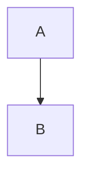

# OXN Simple 主题说明

> 本文对应仓库分支 `1119j` 中的 `src/themes/typecho-theme-oxn/`。  
> OXN 是从 Typecho Warm 独立复制出来并持续定制的主题。本文说明当前代码中的功能、后台配置、前台行为、与原版的差异，以及文章内容的输入语法。

---

## 1. 主题定位与来源

- **主题 ID：** `typecho-theme-oxn`
- **主题名称：** Oxn Simple
- **原版来源：** `src/themes/typecho-theme-warm/`（对照分支 `1119d`）
- **OXN 目录：** `src/themes/typecho-theme-oxn/`（维护分支 `1119j`）
- **主要文件：**
  - `theme.json`：主题元数据、后台设置项及自定义设置界面。
  - `style.css`：主题布局、文章排版、响应式样式、亮色和暗色主题。
  - `components/Index.astro`：首页、文章列表、笔记流和置顶文章。
  - `components/Post.astro`：文章、密码文章、笔记详情及文章声明。
  - `components/Page.astro`：独立页面。
  - `components/WarmShell.astro`：全站外壳、导航、快捷按键、页脚、搜索弹窗和主题切换。
  - `components/WarmComments.astro`、`WarmCommentList.astro`：评论组件、评论列表和管理操作。
  - `components/WarmNoteMedia.astro`：笔记图片、视频、音频和附件。
  - `components/WarmStreamPagination.astro`：列表分页及后续内容加载。
  - `components/warm.ts`：主题设置读取、图片参数转换、置顶 ID 解析、目录生成和声明变量替换。
  - `components/instantclick.ts`、`viewimage.ts`：页面切换与图片查看相关脚本。

OXN 保留 Warm 的单栏、简洁阅读方向和主要页面结构，但后台设置、快捷操作、笔记列表兼容、置顶、管理交互、表单、弹窗、暗色配色及部分内容展示已经按 OXN 的需求进行了定制。它不是与原版完全相同的主题副本。

## 2. 为什么需要一处核心路由兼容修改

### 2.1 原因

主题组件只能在核心路由完成页面类型判断、准备好页面数据后运行。首页入口 `src/pages/index.astro` 会先判断当前主题、读取文章列表，并在没有普通文章数据时决定是否直接返回 404。

笔记插件的某些入口可能只有笔记或话题结果，没有普通文章列表。如果核心路由提前按“没有文章”返回 404，OXN 的 `Index.astro` 根本没有机会执行，单靠主题组件内部无法补救。

### 2.2 当前采用的最小兼容方式

核心入口对 OXN 做了明确识别：当当前主题为 `typecho-theme-oxn`、笔记插件已启用，并且访问的是笔记/话题流入口时，允许空的普通文章列表继续进入主题组件。

这处修改的目的仅是**让 OXN 的笔记流有机会完成自己的数据读取和渲染**，不是把笔记业务搬进核心，也不是修改数据库结构或改变所有主题的空列表规则。

对应位置：

- 核心入口：`src/pages/index.astro`
- OXN 笔记流：`src/themes/typecho-theme-oxn/components/Index.astro`

### 2.3 为什么不把这段逻辑写进主题

因为核心路由的 404 判断发生在主题模板执行之前。主题无法拦截一个尚未被交给主题的请求，所以必须在路由层增加这个很小的主题兼容条件。

除此之外，OXN 的布局、排版、弹窗、密码表单、置顶展示、页脚、图片显示等主题表现，优先在 OXN 目录内实现。不要为了调整主题外观或主题交互而随意修改 Typecho 核心文件。

> 注意：Markdown 转换和文章 HTML 清理仍属于项目共享内容处理流程，不是 OXN 自己重新实现的一套 Markdown 引擎。OXN 使用处理后的文章 HTML，并在主题内部完成排版和展示。

## 3. 与原版 Typecho Warm 的主要差异

| 项目 | 原版 Warm（`1119d`） | OXN（`1119j`） |
| --- | --- | --- |
| 主题身份 | `typecho-theme-warm` | 独立 ID：`typecho-theme-oxn` |
| 设置界面 | 原版的常规主题选项 | 增加 OXN 专属的 CY 风格设置区域和更多前台控制项 |
| 设置隔离 | 使用 Warm 主题配置命名空间 | OXN 自有设置使用 OXN 命名空间；部分旧 Warm 配置仍有兼容读取逻辑 |
| 首页置顶 | 原版没有 OXN 这套按文章 ID 管理的置顶界面 | 可配置多个文章 ID，只作用于首页 |
| 顶部快捷操作 | 原版基础导航 | 可单独控制明暗切换、搜索和后台登录入口 |
| 评论管理操作 | 原版评论交互 | 管理员可在文章/独立页面评论区使用管理操作；可控制前台管理按键是否显示 |
| 页脚 | 原版社交信息和基础页脚 | 增加 10 组自定义页脚链接及自定义 HTML |
| 文章声明 | 原版没有 OXN 这套声明设置 | 支持 HTML、站点/文章变量，显示在文章正文之后、评论之前 |
| 密码文章表单 | 原版页面样式 | 与 404 搜索表单共用一套控件样式 |
| 搜索 | 原版基础页面 | 顶部搜索弹窗 |
| 管理弹窗 | 原版基础交互 | 搜索、置顶、删除等弹窗采用统一圆角与字号规范 |
| 暗色模式 | 原版基础配色 | OXN 统一主题变量，并对标题、正文加粗等暗色文字做了对比度调整 |
| 代码块 | 原版代码展示 | 增加复制图标，复制成功显示绿色勾号 |
| 图片 | 原版基础排版 | 正文图片限制在阅读栏宽度内，统一小圆角；支持主题图片参数 |
| 笔记媒体 | 依赖笔记插件数据 | 笔记图片网格、更多图片展开、视频、音频和附件卡片 |
| 文章目录 | 原版基础内容展示 | 自动识别正文 H2/H3，达到条件时生成目录 |
| 列表加载 | 保留手动/自动模式 | 支持手动加载、滚动加载两次和无限滚动，并可独立配置评论加载 |

以上对比描述的是当前 OXN 代码和已知原版配置，不代表原版项目所有历史版本的差异。

## 4. 后台设置说明

进入后台的主题设置页面，选择 OXN 后可以看到 OXN 自己的设置区域。不同设置的作用范围如下。

### 4.1 主题功能按键

| 设置项 | 开启后的前台表现 | 关闭后的表现 |
| --- | --- | --- |
| 明暗切换 | 页头显示显示模式按键，可选择明亮、跟随系统、暗黑 | 隐藏主题切换按键 |
| 搜索按键 | 页头显示搜索图标，点击打开搜索弹窗 | 隐藏顶部搜索入口 |
| 登录按键 | 页头显示后台入口图标 | 隐藏前台后台入口，不影响后台本身 |
| 评论区管理按键 | 在符合权限的文章/独立页面评论区显示管理员操作按键 | 只隐藏前台操作按键，不撤销后台管理权限，也不关闭管理接口 |

明暗模式支持明亮、跟随系统、暗黑三种状态。当前模式图标会随状态变化。页面切换时主题脚本会处理当前页面状态。

### 4.2 首页置顶文章 ID

- 填写文章的数字 ID。
- 多篇文章使用英文逗号分隔，也接受空格或中文逗号分隔。
- 例如：`12, 35, 108`。
- 只处理已发布、已到发布时间的普通文章。
- 只作用于首页文章列表，不影响分类、归档、笔记流或文章详情页。
- 置顶文章按填写 ID 的顺序组织；首页原列表中对应文章会避免重复显示。
- 无效 ID、重复 ID、非正整数会被忽略。
- 置顶状态还会在管理员文章操作区显示，并可通过管理操作进行置顶/取消置顶。

### 4.3 页脚链接

提供 10 组链接，每组包含：

- **文字：** 前台链接显示的名称。
- **网址：** 链接目标。
- **新窗口打开：** 勾选后在新窗口打开。

可使用完整的 `https://`、`http://`、`mailto:` 地址，也可填写站内链接。普通域名可直接填写。空白链接不会显示。

页脚还会按可用情况显示 RSS、GitHub、社交主页和 Email 等已有站点信息。外部链接会经过主题的 URL 校验；无效的外部地址不会作为链接输出。

### 4.4 文章内容声明

文章内容声明用于在普通文章详情页添加版权说明、转载声明、来源说明或自定义提示。

- 留空时不显示。
- 仅文章详情页显示。
- 位于正文和文章标签之后、评论区之前。
- 笔记详情不显示文章声明。
- 支持 HTML。
- 支持下文列出的站点和当前文章变量。
- 变量替换值会进行 HTML 转义，避免变量内容被当成 HTML 标签解释。

可用变量：

| 变量 | 替换内容 |
| --- | --- |
| `{site.name}` | 网站名称 |
| `{site.url}` | 网站首页地址 |
| `{site.description}` | 网站简介 |
| `{post.title}` | 当前文章标题 |
| `{post.url}` | 当前文章完整访问地址 |

示例：

```html
<div class="article-notice">
  <strong>版权声明</strong>
  <p>本文由「{site.name}」发布。</p>
  <p>文章：<a href="{post.url}">{post.title}</a></p>
  <p>转载请注明出处：{site.url}</p>
</div>
```

如需自定义样式，建议给声明自身使用独立 class，并将 CSS 选择器限制在该 class 下，避免影响全站其他元素。声明内容属于管理员主动填写的 HTML，请只填写可信内容；不要粘贴来源不明的脚本。

### 4.5 站点底部内容

- 支持填写 HTML。
- 显示在全站页脚链接和版权信息之前。
- 留空时不输出自定义内容。
- 其中的 `<style>` 样式会由主题处理并限制到页脚自定义内容容器内，避免普通选择器影响页面其他区域。
- 不要把不可信来源的脚本或 HTML 粘贴到这里。

### 4.6 图片优化参数

**图片优化参数**

- 用于主题正文内容中的站内图片，以及笔记原图/灯箱打开的图片。
- 示例：`?quality=80`。
- 参数会由主题转换为图片服务使用的 URL 参数。
- `width`、`height` 可转换为 EdgeOne 的 resize 参数；`format` 支持映射为格式参数。
- 图片服务自身支持的其他参数会按原样保留。
- 具体压缩质量仍取决于图片服务的配置，不能仅凭填写参数保证所有图片都会按指定质量重新编码。

**缩略图优化参数**

- 用于主题缩略图位置，例如笔记图片网格和列表中的缩略图。
- 示例：`?quality=80&width=500`。
- 留空时回退使用“图片优化参数”。
- 正文图片和缩略图可分别配置尺寸。

参数示例：

```text
图片优化参数：?quality=80&format=webp
缩略图优化参数：?quality=75&width=500&format=webp
```

### 4.7 内容列表

控制首页、分类和笔记内容列表的后续页面加载方式。

| 选项 | 行为 |
| --- | --- |
| 手动加载 | 默认方式。用户点击“加载更多”才请求下一页 |
| 滚动加载 2 次 | 用户开始滚动后，最多自动触发两次后续加载；之后仍可手动点击 |
| 无限滚动加载 | 用户滚动到加载位置时持续加载后续页，直到内容结束 |

加载失败会显示重试提示。分页仍保留上一页/下一页地址语义。用户选择“手动加载”时，不会因为页面滚动而自动请求下一页。

### 4.8 评论组件

控制评论表单组件及其表单配置何时加载。

| 选项 | 行为 |
| --- | --- |
| 手动加载 | 用户主动触发后再加载评论组件 |
| 停留 3 秒加载 | 页面停留达到设定时间后加载 |
| 自动加载 | 页面初始化时加载 |

该项控制评论组件/表单的加载时机，不等同于评论列表的分页加载方式。

### 4.9 评论列表

控制评论内容列表的初始加载及后续分页。

| 选项 | 行为 |
| --- | --- |
| 手动加载 | 用户主动点击后加载评论列表 |
| 加载第一页 | 自动加载第一页，后续页仍按分页交互 |
| 滚动加载 2 次 | 滚动时最多自动加载两次后续评论 |
| 无限滚动加载 | 滚动到列表底部时持续加载，直到评论全部加载 |

“评论组件”和“评论列表”是两个独立设置：前者决定评论表单何时出现，后者决定评论内容何时加载及如何翻页。

### 4.10 主题设置导出与导入

OXN 后台主题设置页在原有保存按钮旁提供：

- **导出设置：** 将当前 OXN 主题配置导出为本地 JSON 文件。
- **导入设置：** 选择此前导出的 JSON 备份，校验文件格式、版本和主题 ID 后，确认导入。
- 导入会覆盖当前 OXN 主题设置。
- 备份只包含 OXN 主题配置，不是数据库备份，也不包含其他主题、插件或系统配置。
- 这是手动备份/恢复，不是主题切换时自动保存或自动恢复。切换主题前先导出；切回 OXN 后再导入备份。

建议每次进行大规模主题设置调整前先导出一份 JSON 备份。

## 5. 前台页面与功能说明

### 5.1 首页、文章列表与分类

- 首页使用单栏文章流。
- 文章卡片显示发布时间、分类、标题和摘要。
- 首页置顶文章按后台 ID 设置展示。
- 分类、归档等列表沿用主题列表样式和分页组件。
- 列表后续页加载行为由“内容列表”设置控制。

### 5.2 笔记流

启用 `typecho-plugin-notes` 后，主题可显示笔记入口和笔记内容。

- 顶部导航出现“笔记”入口。
- 支持笔记列表和话题筛选。
- 首页可根据请求参数显示文章与笔记混合流；也可进入单独笔记流。
- 笔记详情不显示普通文章标题区、文章标签和文章内容声明。
- 笔记正文由笔记插件提供，主题负责排版及媒体展示。
- 笔记图片以网格显示，超过四张时可点击 `+N` 展开剩余图片。
- 支持笔记视频、音频播放器和附件链接卡片。
- 笔记媒体展示依赖笔记插件提供的数据；未启用插件时，主题不会凭空生成笔记内容。

### 5.3 文章详情

普通文章详情页包含：

- 分类、发布时间和预计阅读时间。
- 文章标题和可用的摘要。
- 正文、文章目录（符合生成条件时）。
- 标签。
- 可用时显示文章内容声明。
- 评论组件和评论列表。

文章摘要可使用已安装并启用的 Intelligence 插件生成的智能摘要；没有摘要时使用文章内容生成普通摘要。未通过密码验证的文章不会泄露正文摘要。

### 5.4 密码保护文章

密码文章继续使用项目原有的文章密码验证流程，主题只负责展示输入界面：

- 未验证时不输出受保护的正文。
- 显示提示“此内容已加密，请输入密码访问。”
- 输入框使用 `type="password"`，输入内容默认隐藏。
- 表单通过 GET 参数 `password` 提交当前文章密码。
- 密码验证成功后由原有页面数据流程提供正文。
- 密码表单与 404 搜索表单共用 `warm-compact-form` 这一套布局和控件样式。
- 密码文章未验证时不会输出普通正文摘要，也不会显示正文目录。

主题没有另造一套密码验证接口，也不会因为隐藏输入框就绕过原有权限验证。

### 5.5 独立页面

独立页面使用 OXN 的全站外壳、导航、页脚和文章正文排版。评论开启且满足条件时显示评论区。管理员在有权限且前台管理按键开关开启时，可看到对应管理入口。

### 5.6 评论与管理员操作

评论区域由独立组件管理，包含：

- 评论表单和评论者信息。
- 评论列表、回复关系和分页。
- 评论状态提示。
- 根据站点评论设置显示 Markdown 提示。
- 根据站点配置控制头像、网址、邮箱等字段。
- 评论表单可传递密码文章上下文和安全令牌。
- 管理员可看到编辑、删除等操作；普通访客不会因为前台按钮设置而获得管理权限。

文章/独立页面的管理操作按内容类型区分：

- 文章：置顶/取消置顶、编辑、删除。
- 独立页面：编辑、删除，不提供文章置顶。
- 删除、置顶等危险操作通过主题管理弹窗确认。
- 管理操作仍由已有后台权限和管理接口校验；隐藏按钮不是安全边界。

### 5.7 搜索、导航和页脚

- 顶部搜索图标打开搜索弹窗，提交后使用站内搜索参数。
- 404 页面提供搜索表单，使用与密码文章表单相同的紧凑表单样式。
- 顶部快捷操作可按后台开关分别显示。
- 导航包含首页、文章下拉菜单、可用的笔记入口和已配置的独立页面。
- 页脚可显示自定义链接、RSS、社交信息及自定义 HTML。

### 5.8 图片、灯箱和代码块

- 正文图片最大宽度限制在文章阅读区域内，保持原始宽高比例。
- 正文图片使用统一的小圆角。
- 笔记图片使用网格布局，图片点击后进入图片查看器。
- 图片优化参数和缩略图参数由主题配置控制。
- 代码块右上角提供复制图标；复制成功短暂显示绿色勾号，随后恢复复制图标。
- 图片查看与页面切换脚本会处理页面 DOM 更新后的绑定。

## 6. 文章内容输入语法

文章正文由项目共享 Markdown 流程处理：先解析 Markdown，再进行 HTML 清理，最后交给 OXN 的正文容器展示。下面列出当前处理流程明确支持的常用写法。

### 6.1 标题

```markdown
# 一级标题
## 二级标题
### 三级标题
#### 四级标题
##### 五级标题
###### 六级标题
```

主题会为正文标题设置对应字号和层级。文章目录只提取 H2、H3；至少有两个有效标题时才显示目录，并为标题补充唯一锚点 ID。

### 6.2 段落与换行

普通文字之间空一行形成新段落：

```markdown
这是第一段文字。

这是第二段文字。
```

### 6.3 加粗、斜体、删除线

```markdown
**这是加粗文字**

*这是斜体文字*

~~这是删除线文字~~

普通文字中也可以使用 **局部加粗**。
```

### 6.4 引用

```markdown
> 这是一段引用。
>
> 引用可以包含多个段落。
```

### 6.5 有序和无序列表

```markdown
- 苹果
- 香蕉
- 橙子

1. 第一步
2. 第二步
3. 第三步
```

### 6.6 任务列表

```markdown
- [x] 已完成
- [ ] 尚未完成
```

任务列表的最终呈现还会受到 Markdown 解析器输出和 HTML 清理规则影响。

### 6.7 链接

```markdown
[访问项目主页](https://github.com/oxn/typecho-workers)

[打开站内页面](/about/)
```

### 6.8 图片

```markdown


```

正文图片可使用 Markdown 图片语法，也可输入符合清理规则的 HTML ``。图片的宽度、圆角和最大显示范围由主题 CSS 控制；图片服务参数由后台图片优化设置控制。

### 6.9 行内代码和代码块

行内代码：

```markdown
使用 `npm run build` 执行构建。
```

多行代码：

````markdown
```ts
interface User {
  id: number;
  name: string;
}

const user: User = {
  id: 1,
  name: "Oxn",
};
```
````

代码围栏后面的 `ts`、`js`、`html`、`css`、`bash` 等语言标识会作为代码块 class 信息保留，供代码高亮样式或相关工具识别。主题会为代码块添加复制按钮。

### 6.10 表格

```markdown
| 名称 | 说明 | 状态 |
| --- | --- | --- |
| 文章 | 普通文章内容 | 已支持 |
| 笔记 | 笔记插件内容 | 已支持 |
| 页面 | 独立页面 | 已支持 |
```

表格使用横向可滚动的布局，较宽表格不会强行压缩所有列。

### 6.11 分隔线

```markdown
正文上半部分。

---

正文下半部分。
```

### 6.12 GitHub 风格提示块

支持项目 Markdown 流程中的 GitHub 风格提示块转换：

```markdown
> [!NOTE]
> 这是一条普通提示。

> [!TIP]
> 这是一条技巧提示。

> [!WARNING]
> 这是一条警告提示。
```

当前主题为 NOTE、TIP、WARNING 提供了不同的边框和标题颜色。

### 6.13 HTML 内容

文章 Markdown 中可以混用普通 HTML，但最终输出必须通过项目共享的 HTML 清理规则。当前清理配置在 `src/lib/markdown.ts`，并非 OXN 可以单独绕过的功能。

明确额外允许的常用标签包括：

- 标题：`h1` 至 `h6`
- 图片：`img`
- 代码：`pre`、`code`
- 表格：`table`、`thead`、`tbody`、`tr`、`th`、`td`
- 内容标记：`del`、`ins`
- 折叠内容：`details`、`summary`
- 图片说明：`figure`、`figcaption`
- 媒体：`video`、`audio`、`source`
- 嵌入内容：`iframe`

示例：折叠内容

```html
<details>
  <summary>点击展开更多说明</summary>
  <p>这里是折叠区域中的内容。</p>
</details>
```

示例：视频

```html
<video src="https://example.com/video.mp4" controls></video>
```

示例：音频

```html
<audio src="https://example.com/audio.mp3" controls></audio>
```

### 6.14 iframe 嵌入

当前共享清理配置只允许以下 iframe 主机：

- `www.youtube.com`
- `player.bilibili.com`
- `player.vimeo.com`

示例：

```html
<iframe
  src="https://www.youtube.com/embed/视频ID"
  width="560"
  height="315"
  frameborder="0"
  allowfullscreen>
</iframe>
```

只有允许的主机及允许的属性会保留。其他域名的 iframe 可能被清理掉；不要把普通网页地址直接当作可嵌入播放器地址。

### 6.15 更多内容标记

项目内容流程会识别 Typecho 的 `<!--more-->` 摘要分隔标记，并在最终渲染前处理该标记。它不是普通可见 HTML 注释。

### 6.16 当前不应假定支持的语法

当前 OXN 主题没有自行配置以下渲染引擎：

- Mermaid 流程图。
- KaTeX、MathJax 等数学公式渲染器。
- 任意 SVG 直接输出。
- 任意外部网站 iframe。

因此，不要把下面的写法当作已经可用的主题功能：

````text


$$
E = mc^2
$
````

如果没有另外安装并接入相应插件或渲染器，上述内容不会自动变成流程图或排版后的数学公式。SVG 也不在文章正文共享 HTML 清理配置的明确允许标签中。

## 7. 评论内容输入

评论是否允许 Markdown，取决于站点评论设置。评论表单会根据当前设置显示相应提示。

评论 Markdown 使用独立的清理规则，不能直接套用文章正文的全部 HTML 能力。评论内容允许的 HTML 范围更窄，常见支持包括链接、图片、引用、段落、列表和代码块；不应在评论中依赖视频、音频或 iframe 嵌入。

## 8. 主题样式与响应式规则

- 单栏阅读布局，正文宽度以主题变量控制。
- 文章正文图片限制在阅读栏宽度内，不再通过图片样式突破到宽屏区域。
- 正文图片采用统一小圆角。
- 代码块、表格、引用、提示块和目录均有独立样式。
- 手机端会缩小部分字号、调整页头布局和表单排列。
- 暗黑模式通过主题颜色变量切换背景、边框、正文、弱化文字和强调色。
- 暗黑模式下标题与正文加粗文字使用统一的柔和正文颜色，避免出现过亮的纯白文字。
- 搜索弹窗、置顶/删除管理弹窗使用统一圆角风格；弹窗标题统一为 1.2rem、加粗，说明文字保持正文大小。

## 9. 插件与系统依赖边界

| 能力 | 依赖或来源 | 说明 |
| --- | --- | --- |
| 普通文章、独立页面、密码验证 | Typecho Workers 核心内容与权限流程 | 主题负责页面显示，不替代核心验证 |
| Markdown 转 HTML、文章 HTML 清理 | 项目共享 `src/lib/markdown.ts` | 全站共用，不是 OXN 私有解析器 |
| 笔记流和笔记媒体 | `typecho-plugin-notes` | 未启用时不显示笔记入口 |
| 智能摘要 | `typecho-plugin-intelligence` | 插件启用且有摘要时显示，否则使用普通摘要 |
| 评论读写和管理 | 现有评论 API、权限和站点设置 | 主题负责交互界面 |
| 图片优化 | 项目图片 URL 转换能力及配置的图片服务 | 主题负责提供参数和展示尺寸 |

## 10. 修改与维护原则

1. OXN 的主题样式和主题组件优先在 `src/themes/typecho-theme-oxn/` 内维护。
2. 不要把 OXN 的修改误写到原版 `typecho-theme-warm` 或其他主题目录。
3. 不要为了主题外观调整去修改核心数据库结构、文章存储或权限逻辑。
4. 笔记流的核心入口兼容条件属于已知的必要路由例外；除非确认替代方案，不要随意删除，否则笔记专属入口可能在主题组件运行前被核心路由判为 404。
5. Markdown 解析和 HTML 清理属于共享核心流程。若要扩大所有文章可用的 HTML 标签或嵌入协议，应先评估全站安全影响，不要在主题中假设可以绕过清理。
6. 修改后台配置字段时，应同步检查 `theme.json`、`components/warm.ts` 的读取逻辑和实际前台使用位置。
7. 修改加载模式时，应区分内容列表、评论组件和评论列表三套设置，不要混为一个开关。
8. 修改管理员操作按钮时，必须保留后端权限校验；前台隐藏按钮不代表撤销权限。
9. 主题设置备份是手动导出/导入机制，升级或切换主题前请自行保留 JSON 备份。

---

**文档维护说明：** 本文件描述的是当前 OXN 源码中能够确认的行为。项目核心路由、共享 Markdown 清理配置或插件接口发生变化时，应同步复核本文对应章节，避免把历史行为误写成当前功能。
